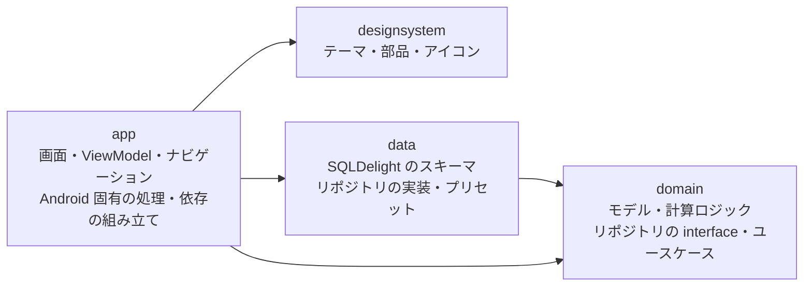

# training-log（Android）

筋トレ記録アプリ（仮称 training-log）の Android 版です。Kotlin + Jetpack Compose + SQLite（SQLDelight）で、サーバーを持たず、端末の中だけで動きます。

- 要件定義: [`../docs/requirements.md`](../docs/requirements.md)
- 画面のデザイン: [`../design/README.md`](../design/README.md)
- 進行の記録: [Issue #5](https://github.com/o-TAT-o/inventory/issues/5)

## 動かす・確かめる

必要なもの: JDK 21、Android SDK（compileSdk 37、build-tools 36）。Android Studio は要りません（コマンドラインだけで動きます）。

```bash
cd apps/training-log/android

# SDK の場所を教える（コミットしない。local.properties は .gitignore に入っている）
echo "sdk.dir=/path/to/Android/Sdk" > local.properties

./gradlew :domain:test :data:test :app:testDebugUnitTest   # ユニットテスト
./gradlew :app:lintDebug                                   # Lint
./gradlew :app:assembleDebug                               # デバッグ APK（app/build/outputs/apk/debug/）
```

エミュレーターや実機に入れるときは、`adb install -r app/build/outputs/apk/debug/app-debug.apk`。
main に push すると、CI が同じ内容を確かめ、デバッグ APK を GitHub の [プレリリース `training-log-dev`](https://github.com/o-TAT-o/inventory/releases/tag/training-log-dev) に置きます（スマホのブラウザから入れられます。署名の鍵は `app/debug.keystore` で共通なので、上書きインストールできます）。

## 構成（責任ごとにモジュールを分ける）



| モジュール | 持つもの | 持たないもの |
|-----------|----------|--------------|
| `domain` | モデル、重量の単位変換、ボリューム（片側・左右計）、自己ベスト、1日の区切り、休憩時間、次のルーティンの提案、ワークアウトの下書き、リポジトリの interface、ユースケース | Android・DB・画面への依存（純粋な Kotlin。iOS と共有できるように） |
| `data` | SQLDelight のスキーマ（`src/main/sqldelight`）、リポジトリの実装、初回のプリセット（種目・ギア）、`DataModule`（入口） | Android への依存（ドライバーは `app` が渡す） |
| `designsystem` | 色・文字のトークン（デザインの `C14_tokens` と同じ値）、ボタン・± の入力・チップ・タブ・ダイアログ、アイコン | ビジネスロジック |
| `app` | 画面（Compose）、ViewModel、ナビゲーション、通知・振動、`AppContainer`（DI のフレームワークは使わない） | 計算の本体（`domain` に置く） |

### 画面（`app/.../feature/<画面>/`）の分け方

1 つの画面は、次の 3 つに分けます。

- **UiState（`*UiModels.kt`）**: 画面が描くのに必要な値だけを持つ、ただのデータ
- **ViewModel**: DB と計算ロジックから UiState を組み立て、操作を受け取る。Android の画面部品には触れない
- **Screen（Composable）**: UiState を描き、操作を ViewModel に伝えるだけ。状態は持たない（ダイアログの開閉など、見た目だけの状態を除く）

記録画面は、組み立てを `WorkoutUiMapper`（DB にも Android にも触れない純粋な関数）に分けてあり、ViewModel を通さずにテストできます。

## 決めたこと

- **minSdk 26（Android 8.0）**: 要件定義 7 章の「下限は設計時に決める」の答え。SQLite の方言は 3.18 に合わせたので、`INSERT ... ON CONFLICT`（upsert）や窓関数は使えない。更新は「あれば UPDATE、なければ INSERT」で書く。
- **compileSdk 37 / targetSdk 36**: 最新の Compose・Navigation が compileSdk 37 を求める。
- **入力はすぐ画面に出し、少し遅れて保存する**: ± を速く押しても取りこぼさない（`WorkoutViewModel` の `Draft` と保存の待ち行列）。次のセットには、いま入力した値が引き継がれる（F-WO-03）。
- **休憩は完了したセットで決まる**: 種目の最後のセットなら「種目のあと」、それ以外は「セット間」（F-TM-05）。最後の種目の最後のセットでは始めない。
- **「今日」は 1日の区切りで決まる**: 初期値は 4:00。夜中に始めた記録は前の日になる（F-SE-08、`DayBoundary`）。
- **自動バックアップは使わない**: データは端末の中だけ。バックアップは、ファイルへの書き出しで行う（F-DA-02）。
- **データモデルは要件定義の ER 図に、次を足している**: 部位は列挙型（`BodyPart`）で持つ。ワークアウトの種目に、休憩時間（`rest_seconds` / `rest_after_seconds`）を複写して持つ（ルーティンを後から変えても、記録中の休憩が変わらないように）。種目に、重量の刻み（`weight_step_kg`）を持てる。

## テスト

- `domain`（47 件）: 計算ロジック（ボリューム表の全行、自己ベスト、1日の区切り、休憩、下書き、日付の帯）
- `data`（24 件）: メモリ上の SQLite で、リポジトリとユースケースを本物のまま動かす
- `app`（42 件）: 画面の組み立て（`WorkoutUiMapper`）、書式、ViewModel（記録画面・ホーム）を、メモリ上の DB で動かす

ViewModel のテストは、仮想時間（`runTest`）ではなく本物の時間で動かし、終わったら ViewModel を止める（`testing/ViewModelTestSupport.kt`）。ViewModel が「1 秒ごとのタイマー」のような終わらない処理を持つため、仮想時間で動かすとテストが終わらなくなる。

## まだないもの（あとで）

グラフの期間切り替え、ギアの管理画面、バリエーション、調整項目（ベンチ角度など）、並べ替えのドラッグ、書き出し・読み込み、乗り換え用の取り込み、休憩のバックグラウンド通知（アプリが閉じているとき）、広告・課金、「あとから入力」の簡易入力。詳しくは [Issue #5](https://github.com/o-TAT-o/inventory/issues/5)。
