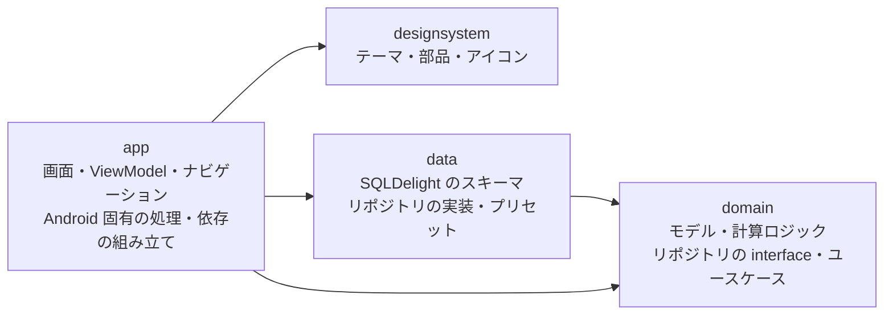

# training-log（Android）

筋トレ記録アプリ（仮称 training-log）の Android 版です。Kotlin + Jetpack Compose + SQLite（SQLDelight）で、サーバーを持たず、端末の中だけで動きます。

- 要件定義: [`../docs/requirements.md`](../docs/requirements.md)
- 画面のデザイン: [`../design/README.md`](../design/README.md)
- 進行の記録: [Issue #5](https://github.com/p-ota-q/inventory/issues/5)

## 動かす・確かめる

必要なもの: JDK 21、Android SDK（compileSdk 37、build-tools 36）。Android Studio は要りません（コマンドラインだけで動きます）。

```bash
cd apps/training-log/android

# SDK の場所を教える（コミットしない。local.properties は .gitignore に入っている）
echo "sdk.dir=/path/to/Android/Sdk" > local.properties

./gradlew :domain:test :data:test :app:testDebugUnitTest   # ユニットテスト
./gradlew :app:lintDebug                                   # Lint
./gradlew :app:assembleDebug                               # デバッグ APK（app/build/outputs/apk/debug/）
```

エミュレーターや実機に入れるときは、`adb install -r app/build/outputs/apk/debug/app-debug.apk`。
main に push すると、CI が同じ内容を確かめ、デバッグ APK を GitHub の [プレリリース `training-log-dev`](https://github.com/p-ota-q/inventory/releases/tag/training-log-dev) に置きます（スマホのブラウザから入れられます。署名の鍵は `app/debug.keystore` で共通なので、上書きインストールできます）。

## 構成（責任ごとにモジュールを分ける）



| モジュール | 持つもの | 持たないもの |
|-----------|----------|--------------|
| `domain` | モデル、重量の単位変換、ボリューム（片側・左右計）、自己ベスト、1日の区切り、休憩時間、次のルーティンの提案、ワークアウトの下書き、乗り換え用の初期値（`Baselines`）、リポジトリの interface、ユースケース | Android・DB・画面への依存（純粋な Kotlin。iOS と共有できるように） |
| `data` | SQLDelight のスキーマ（`src/main/sqldelight`）、リポジトリの実装、初回のプリセット（種目・ギア）、`DataModule`（入口） | Android への依存（ドライバーは `app` が渡す） |
| `designsystem` | 色・文字のトークン（デザインの `C14_tokens` と同じ値）、ボタン・± の入力・チップ・タブ・ダイアログ、アイコン | ビジネスロジック |
| `app` | 画面（Compose）、ViewModel、ナビゲーション、通知・振動、`AppContainer`（DI のフレームワークは使わない） | 計算の本体（`domain` に置く） |

### 画面（`app/.../feature/<画面>/`）の分け方

1 つの画面は、次の 3 つに分けます。

- **UiState（`*UiModels.kt`）**: 画面が描くのに必要な値だけを持つ、ただのデータ
- **ViewModel**: DB と計算ロジックから UiState を組み立て、操作を受け取る。Android の画面部品には触れない
- **Screen（Composable）**: UiState を描き、操作を ViewModel に伝えるだけ。状態は持たない（ダイアログの開閉など、見た目だけの状態を除く）

記録画面は、組み立てを `WorkoutUiMapper`（DB にも Android にも触れない純粋な関数）に分けてあり、ViewModel を通さずにテストできます。

## 決めたこと

- **minSdk 26（Android 8.0）**: 要件定義 7 章の「下限は設計時に決める」の答え。SQLite の方言は 3.18 に合わせたので、`INSERT ... ON CONFLICT`（upsert）や窓関数は使えない。更新は「あれば UPDATE、なければ INSERT」で書く。
- **compileSdk 37 / targetSdk 36**: 最新の Compose・Navigation が compileSdk 37 を求める。
- **入力はすぐ画面に出し、少し遅れて保存する**: ± を速く押しても取りこぼさない（`WorkoutViewModel` の `Draft` と保存の待ち行列）。次のセットには、いま入力した値が引き継がれる（F-WO-03）。
- **休憩は完了したセットで決まる**: 種目の最後のセットなら「種目のあと」、それ以外は「セット間」（F-TM-05）。最後の種目の最後のセットでは始めない。
- **「今日」は 1日の区切りで決まる**: 初期値は 4:00。夜中に始めた記録は前の日になる（F-SE-08、`DayBoundary`）。
- **サイズ**: 公開用のビルド（R8 と資源の圧縮あり。`./gradlew :app:assembleRelease`）は **4.3 MB**（2026-11-16。広告と課金の SDK を入れたあと。入れる前は 1.8 MB。目標は 10 MB 以下。要件定義 7 章）。公開用のビルドは、R8 がクラスを消して落ちることがあるので、SDK を足したら、実際に入れて起動を確かめる（`proguard-rules.pro` に、WorkManager のための規則がある）。デバッグ版は 13 MB（開発用の部品が入るため）。
- **OS の自動バックアップは使わない**: データは端末の中だけ。バックアップは、ファイルへの書き出し（共有機能で、好きな場所へ）で行う（F-DA-02）。それとは別に、ワークアウトを終えるたびに、アプリの中に直近 3 回分の写しを残す（F-DA-10。`platform/BackupFiles.kt`）。復元の前にも、いまのデータを写しに残す。
- **乗り換え用の初期設定は、記録とは別の表に持つ（`exercise_baseline`）**: 日付のない「直近の値」を記録に混ぜると、履歴・グラフ・ボリュームに出てしまうため。「前回の記録」は、その種目の記録がないあいだだけ初期設定から作り（画面には「前回（前のアプリ）」と出る）、自己ベストは、記録と初期設定の大きいほうで判定する（F-DA-05、F-DA-06。`Baselines`）。入力は打つたびに保存し、「保存する」ボタンは画面を閉じるだけ。
- **データベースのバージョンは 2**: 上の表を足したのが、最初のマイグレーション（`data/src/main/sqldelight/migrations/1.sqm`）。`SchemaMigrationTest` で、バージョン 1 のデータを移しても種目が残ることを確かめている。
- **ほかのアプリのファイルの取り込み（CSV など）は作らない**: 一般の利用者には難しいため（要件定義 v1.8）。乗り換えは手入力。このアプリが書き出したファイル（JSON）からの復元だけがある（F-DA-03）。
- **乗り換え用の初期設定のセット数は、空欄でもよい。日付は持たない**（要件定義 v1.9）: 入れていれば、前回の記録をそのセット数で出し、はじめのワークアウトのセット数にも使う（`PreviousRecord.setCountKnown`）。入れていなければ、これまでどおり 3 セット。日付は、種目ごとに入れる手間が大きいわりに、使い道がない。
- **データベースのバージョンは 3**: `2.sqm` で、部位の「腕」を、プリセットの id と名前から「二頭」「三頭」に分け、初期設定にセット数の列を足した。**後から足した列は、表の定義（`.sq`）でも末尾に置く**（`SELECT *` が列の並びで読むため。移したデータベースと新しく作ったデータベースで、並びを揃える）。`SchemaMigrationTest` が、バージョン 2 のデータ（腕の種目・初期設定）を移して確かめている。
- **ボタンの「無効」は、`Modifier.alpha` を付けたり外したりして表さない**: 無効から有効に変わった瞬間に、ボタン全体が描かれなくなる不具合があった（種目の追加の「保存」が、名前を入れると見えなくなった）。文字とアイコンの色の濃さだけで表す（`Buttons.kt`）。
- **データベースのバージョンは 5**: `3.sqm` で調整項目の表、`4.sqm` で「あとから入力」の印（`workout.quick_entry`）を足した。
- **並べ替えのつまみ（≡）は、行の見た目が変わっても、同じ場所に 1 つだけ置く**: 記録画面は、ドラッグを始めると、種目を見出しだけにたたむ。見た目ごとに別のつまみを置いていたら、たたんだ瞬間に、押していたつまみが作り直されて、ドラッグが切れた（`WorkoutScreen.kt` の `ExerciseBlock`）。
- **休憩の終わりの通知は、目覚まし（AlarmManager）で出す**: アプリが後ろにあるときだけ出す（前にあるときは、画面の中の音とバイブ）。時刻どおりに出すには、端末の「アラームとリマインダー」の許可が要る（Android 14 以上は、初めは許可されていない）。許可がないあいだは、1 分ほど遅れることがある。設定の「休憩タイマー」に、許可の画面を開く行を出している（`platform/RestNotifier.kt`）。
- **広告と課金の SDK は、使うときに読み込む**: 広告は、バナーを初めて出すとき。Google Play へは、設定を開いたとき。広告を消した人には、広告の SDK を読み込まない（F-AD-07。`platform/Ads.kt`、`platform/RemoveAdsBilling.kt`）。記録中に開いた種目の詳細には、広告を出さない（F-HI-07）。
- **データモデルは要件定義の ER 図に、次を足している**: 部位は列挙型（`BodyPart`）で持つ。ワークアウトの種目に、休憩時間（`rest_seconds` / `rest_after_seconds`）を複写して持つ（ルーティンを後から変えても、記録中の休憩が変わらないように）。種目に、重量の刻み（`weight_step_kg`）を持てる。

## テスト

- `domain`（71 件）: 計算ロジック（ボリューム表の全行、自己ベスト、1日の区切り、休憩、下書き、日付の帯、乗り換え用の初期値、部位の読み替え、グラフの統計・推定 1RM）
- `data`（68 件）: メモリ上の SQLite で、リポジトリとユースケースを本物のまま動かす（乗り換え用の初期設定、マイグレーション（バージョン 1・2 から）を含む）
- `app`（93 件）: 画面の組み立て（`WorkoutUiMapper`）、書式、ViewModel（記録画面・ホーム・乗り換え用の初期設定・種目の選択・ルーティンの編集・種目の編集と詳細・ギアの管理）を、メモリ上の DB で動かす

### ユニットテストと e2e は分けている

| | ユニットテスト | e2e |
|---|---|---|
| 置き場所 | `*/src/test`（`domain` / `data` / `app`） | `app/src/androidTest`（`e2e/`） |
| 動く場所 | パソコンの JVM（メモリ上の SQLite）。エミュレーター不要 | エミュレーターか実機。アプリを本物のまま動かす |
| 見るもの | 計算・保存・ViewModel の状態など、細かい動き | 画面をつないで、人が触る順に操作すると進むこと（最小限） |
| 動かし方 | `./gradlew :domain:test :data:test :app:testDebugUnitTest` | エミュレーターを起動して `./gradlew :app:connectedDebugAndroidTest` |
| CI | ジョブ「テストとビルド」（毎回。数分） | ジョブ「e2e（エミュレーター）」（別のジョブ。並行して動く） |

e2e は最小限にしている（`BasicUserFlowTest`）: ①自由に記録して終え、履歴で見る ②ルーティンを作り、種目を足して目標を決め、そこから始める ③乗り換え用の初期設定を入れ、ワークアウトで前回として出る。テストごとに、アプリのデータを空にして始める（オーケストレーターの `clearPackageData`）。画面の文言で探すので、文言を変えたら e2e も直す。

ViewModel のテストは、仮想時間（`runTest`）ではなく本物の時間で動かし、終わったら ViewModel を止める（`testing/ViewModelTestSupport.kt`）。ViewModel が「1 秒ごとのタイマー」のような終わらない処理を持つため、仮想時間で動かすとテストが終わらなくなる。

## 公開の前にやること

実機で試せるように、ひととおり動く形にしてあります。公開の前に、次を差し替え・確かめます。

- **広告の ID**: `AndroidManifest.xml` のアプリ ID と、`platform/Ads.kt` のバナーの ID は、Google が公開しているテスト用のもの。AdMob で自分の ID を作って差し替える。EU などに出すなら、同意の画面（UMP）も要る
- **広告を消す買い切り**: 商品の ID は `remove_ads`（`platform/RemoveAdsBilling.kt`）。Google Play Console に同じ ID の商品を作るまで、「購入」は「いまは購入できません」になる。デバッグ版には、設定に「（開発用）広告を消した状態にする」のスイッチがある
- **利用規約・プライバシーポリシー**: 文章は `feature/settings/InfoScreen.kt` にある下書き。内容を見直して確定する
- **アプリの名前と applicationId**: 仮のまま（公開後は変えられない）
- **署名の鍵**: 公開用の鍵を作る（いまは、公開用のビルドもデバッグの鍵で署名している）

## いまは入れていないもの

要件定義で「Could」としたものと、v1.x に回したものは、入れていません: セットの種類（ウォームアップ・ドロップ。F-WO-09）、スーパーセット（F-RT-09）、バーの重さを含める設定（F-EX-12）、セットごとのギア（F-GR-05）、グラフのギアでの絞り込み（F-GR-06）、体重の記録、クラウドへのバックアップ（F-DA-11）。詳しくは [Issue #5](https://github.com/p-ota-q/inventory/issues/5)。
