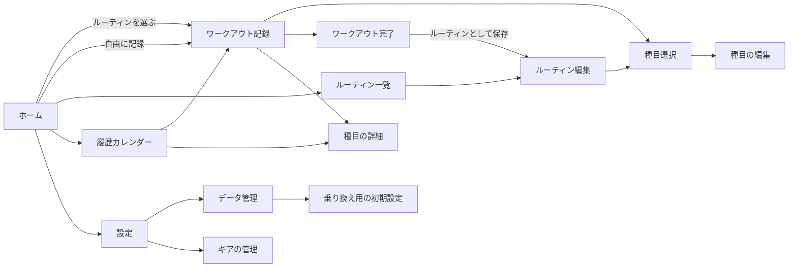

# 画面デザインの指示書（Claude Design 向け）

> 対象: training-log（仮称。アプリ名は未定）
> 元にした要件: [requirements.md](requirements.md) v1.0
> 作成日: 2026-11-14
> 使い方: この文書をそのまま Claude Design に渡す。要件の細かいところを聞かれたら requirements.md も添付する。**ほかの筋トレ記録アプリのスクリーンショットは渡さない。**

---

## 1. お願いしたいこと

Android スマートフォン向けの、筋トレ記録アプリの画面デザインをお願いします。

成果物は次の 3 つです。

1. 全画面のモック（ライト・ダークの両方）
2. ワークアウト記録画面の、実際に操作できるプロトタイプ（セットを完了 → 休憩タイマーが始まる → 次のセットを完了、まで）
3. 色・文字・余白のデザイントークンと、使う部品の一覧

## 2. 進め方

1. **方向性の案を 3 つ** 出してください。描くのは「ホーム」と「ワークアウト記録」の 2 画面だけで構いません。案ごとに、何を狙ったかを一言添えてください。
2. 選んだ案で、全画面を作ってください。
3. ワークアウト記録画面のプロトタイプを作ってください。
4. 見てもらいながら修正します。

---

## 3. アプリの概要

| 項目 | 内容 |
|------|------|
| 何をするアプリか | 筋トレの記録。「今日は Push の日」のように、**ルーティン（メニューのテンプレート）を選ぶだけで記録が始まる** のが中心 |
| 誰が使うか | ジムでフリーウェイトやマシンを中心に、週に数回トレーニングする人。「シンプルに記録だけしたい」「アカウント登録やサブスクは嫌」という人 |
| どこで使うか | ジムで、セットの合間に片手で入力する。汗をかいている、時間がない、画面をじっくり見ない |
| 特徴 | アカウントもサーバーもなく、データは端末の中だけに置く。記録中は広告を出さない。**とことん軽い** |

## 4. デザインの原則（上ほど優先）

1. **片手・数タップ**: 1 セットの記録は「値を確認 → 完了をタップ」の 1 タップで済むのが理想。
2. **前回が見える**: 前回何 kg で何回やったかを、画面を移らずに確認できる。
3. **押し間違えない**: タップ領域を大きくし、よく使うボタンは画面の下半分に置く。
4. **消えない安心感**: 保存ボタンはない（入力した瞬間に保存される）。削除や並べ替えは直後に取り消せる。
5. **静か**: 記録中にポップアップ、広告、お知らせを出さない。
6. **軽い**: 飾りより情報を優先する。画像やイラスト、凝ったアニメーションは使わない。

## 5. 見た目と技術の制約

| 項目 | 制約 |
|------|------|
| 端末 | Android のスマートフォン、縦向き。幅 360dp を基準にし、412dp でも崩れないこと |
| 実装 | Kotlin ＋ Jetpack Compose（Material 3）で作る。**Material 3 の部品で作れる形を基本にする。** 独自の部品は、記録画面の数値入力など本当に必要なところだけにする |
| テーマ | ライトとダークの両方。初期設定は端末の設定に合わせる |
| 文字 | OS 標準のフォントを使い、独自のフォントは入れない。重量や回数の数字は、桁がずれないように等幅の数字にする |
| 文字サイズ | OS の文字サイズを最大にしても崩れないこと |
| タップ領域 | 48dp 以上。記録画面の ± ボタンと「完了」はもっと大きくする |
| アイコン | Material Symbols の中から、使うものだけにする。写真やイラストは使わない |
| 色 | 文字と背景のコントラストは WCAG AA 以上。色だけで情報を伝えない（完了や自己ベストは、形や文字でも分かるようにする） |
| 言語 | 日本語。将来英語を足しても崩れない余裕を持たせる |
| 動き | 状態が変わったことを伝える最小限の動きだけにする |
| 広告 | 記録の画面には置かない。履歴・種目の詳細・設定の画面の下に、バナーの枠の位置だけ示す（広告削除を購入すると消える） |
| アプリ名・ロゴ | 未定。仮の名前で作り、ロゴは作らない |

## 6. 用語（画面の文言で使う言葉）

| 用語 | 意味 |
|------|------|
| 種目 | ベンチプレス、スクワットなどの運動 |
| バリエーション | 同じ種目のフォーム違い。例: ワンハンドダンベルロウの「膝をベンチにつく」と「立って背もたれに手をつく」。親の種目の下に 1 段だけ作れる |
| ルーティン | 種目と目標（セット数・重量・回数）をまとめたテンプレート。例: 「Push」「脚の日」 |
| ワークアウト | 1 回分のトレーニングの記録 |
| セット | 重量と回数などの 1 回分の記録 |
| 重量の数え方 | 記録した重量が「片手」の重さか「合計」か |
| 回数の数え方 | 「通常」（両手・両脚を同時に動かす）/「片側」（片側の回数）/「左右合計」（左右の回数を足したもの） |
| 調整項目 | 種目ごとの器具の設定。例: ベンチ角度 30°、シート位置 4 |
| ギア | ベルト、パワーグリップ、リストラップなど、身に付ける道具 |
| 自己ベスト | その種目でいちばん良かった記録 |

---

## 7. 画面の流れ

画面の移動方法（下のタブにするかなど）も提案してください。

## 8. 画面ごとの内容

### 8.1 ワークアウト記録（最重要）

1 画面に全種目を並べるか、1 種目ずつ大きく表示するかは、案を出してください。

**画面全体**

- ワークアウトの名前（ルーティン名、または「自由に記録」）と経過時間
- ルーティンから始めたときは、ルーティンのメモ（例: 「ベンチが空いていなければダンベルプレスに変更」）。たためるようにする
- 種目の追加・削除・入れ替え。その日だけの変更で、元のルーティンは変わらない
- 種目の並べ替えは、長押しかつまみ（ハンドル）をドラッグするだけ。並べ替え専用のモードに切り替えない。画面の端に近づくと自動でスクロールする
- 「ワークアウトを終える」

**種目ごとの表示**

- 種目名、バリエーション名、器具（アイコンか文字）
- ルーティンに親の種目が入っているときは、その場でバリエーションを選べる（初期値は前回使ったもの）
- **前回の同じ種目の記録**（日付と、各セットの重量×回数）。初めて使うバリエーションなら、同じ親のほかのバリエーションの直近の記録を、どのバリエーションかを添えて表示する
- 調整項目の値（例: ベンチ角度 30°）。前回の値が入っていて、変えなければ触らなくてよい
- 使ったギアのチップ（小さなボタン）。前回その種目で使ったものが選ばれた状態で始まり、タップで付け外しする
- その日の種目ごとのメモ（例: 「3 セット目でフォームが崩れた」）
- 重量と回数の数え方を、その日だけ変える操作（目立たない場所でよい）

**セットの入力**

- セットの行: 重量・回数・完了チェック。完了したセットとまだのセットを見分けられる
- ルーティンの目標セットは、未完了の行として最初から並ぶ
- **次のセットの入力行が、いつも用意されている。** 値は直前のセット（その日の最初のセットなら前回の記録）で埋まっていて、そのまま「完了」をタップすれば記録できる。画面を閉じて開き直しても同じ
- 重量・回数は、大きめの ± ボタンと、数字をタップして出す数値キーボードの両方で入力できる。± の刻みは設定で決める（例: 2.5kg）
- 種目の記録の種類によって、入力する項目が変わる: 「重量×回数」「回数のみ（自重）」「時間」「距離×時間」
- 自己ベストを更新したセットには印を付ける

**休憩タイマー**

- セットを完了すると自動で始まる
- 記録の邪魔をせず、記録を続けながら残り時間がいつも見える
- ± で延長・短縮でき、止められる
- 時間になったら音とバイブで知らせる（アプリが裏にあるときは OS の通知）

**描いてほしい状態**

- 休憩タイマーが動いているとき / 時間になったとき
- 前回の記録がない種目（初めての種目）
- 自己ベストを更新したとき
- 種目をドラッグしているとき
- 削除した直後の「取り消す」
- 数値キーボードを出しているとき
- バリエーションを選ぶとき

### 8.2 ホーム（今日）

- 今日のワークアウトを始める: 「ルーティンから」と「自由に記録」
- 次にやるルーティンの提案（例: Push → Pull → Legs の順で、前回の続きを出す）
- 前回のワークアウトの要約
- 途中のワークアウトがあるときは「再開」
- しばらくバックアップしていないときに、控えめに書き出しを促す表示
- 空の状態: ルーティンがまだ 1 つもないとき

### 8.3 ルーティン一覧

- ルーティンの一覧。ドラッグで並べ替え
- 作成、選んで開始、編集

### 8.4 ルーティン編集

- 名前
- 種目の追加・削除・ドラッグでの並べ替え
- 種目ごとの目標（セット数・重量・回数）。空欄でもよい
- ルーティンのメモ

### 8.5 種目選択

- 部位（胸・背中・脚・肩・腕・腹・全身・有酸素 など）と器具で絞り込む
- 種目名で検索する
- バリエーションは、親の種目の下に折りたたんで表示する
- 新しい種目を追加する

### 8.6 種目の編集

- 名前、部位、記録の種類、器具
- 重量の数え方（片手 / 合計）、回数の数え方（通常 / 片側 / 左右合計）
- 調整項目の定義: 項目名、数値か文字か、単位（例: 「ベンチ角度」「数値」「°」）
- ± の刻みを、この種目だけ変える
- 種目のメモ（例: 「肩甲骨を寄せる」）
- バリエーションの一覧と追加。それまでの記録をバリエーションへまとめて移す操作
- 非表示にする（記録がある種目は削除せず非表示にする）

### 8.7 ワークアウト完了

- その日の要約: 種目数、ボリューム、所要時間、更新した自己ベスト
- ワークアウト全体のメモ
- 「ルーティンとして保存」

### 8.8 履歴（カレンダー）

- 月のカレンダー。トレーニングした日と、鍛えた部位がひと目で分かる
- 日付を選ぶと、その日の記録を見る・直す。過去の日に記録を足すこともできる
- 過去のワークアウトをコピーして、今日のワークアウトを始める
- 下に広告バナーの枠

### 8.9 種目の詳細

- 記録の一覧（新しい順）。重量・回数と数え方、調整項目の値、使ったギアも表示する
- グラフ: 最大重量、推定 1RM、ボリュームの推移。期間を 1 か月 / 3 か月 / 1 年 / 全期間で切り替える
- バリエーションのある種目は、バリエーションごとの表示と、まとめた表示を切り替える
- 自己ベスト、種目のメモ
- 下に広告バナーの枠

### 8.10 データ管理

- 全データの書き出し（1 つのファイルにして、OS の共有機能で好きな場所に保存する）
- 読み込み（復元）。読み込む前に「上書きする」か「やめる」かを確認する
- CSV での書き出し
- 決まった形式のファイルからの取り込み
- 「乗り換え用の初期設定」への入口
- 最後に書き出した日

### 8.11 乗り換え用の初期設定

ほかのアプリから乗り換えるときに、種目ごとの直近の値を手でまとめて入れる画面です。

- 種目ごとに、器具・重量と回数の数え方・直近の重量と回数・自己ベストを、一覧の形でまとめて入力する
- 種目を 1 つずつ開かずに、表のように上から順に素早く入れられること
- ここで入れた値は、初回のワークアウトで「前回の記録」として表示される

### 8.12 設定

- 重量の単位（kg / lb）、± の刻み、テーマ（ライト / ダーク / 端末に合わせる）、週の始まり（日曜 / 月曜）
- 休憩タイマー: 初期の時間、自動で始めるかどうか、音とバイブ
- ギアの管理への入口
- 広告削除の購入、購入の復元
- 利用規約、プライバシーポリシー、ライセンス
- 下に広告バナーの枠

### 8.13 ギアの管理

- ギアの一覧。追加・名前変更・非表示・ドラッグでの並べ替え
- 最初から入っているもの: ベルト、パワーグリップ、リストストラップ、リストラップ、ニースリーブ、エルボースリーブ

## 9. 表示のルール

- **重量の横には必ず「片手」か「合計」を付ける**（例: 「22.5 kg 片手」「60 kg 合計」）。後から見て、片手の重さか合計かで迷わないようにするため
- **回数の横には、片側なら「片側」、左右合計なら「左右計」を付ける**（例: 「10 回 片側」）。通常のときは何も付けない
- 器具は、種目名の近くにアイコンか文字で示す
- 単位は設定に従う（kg / lb）

---

## 10. モックに使うサンプルデータ

**種目**

| 種目 | バリエーション | 器具 | 重量の数え方 | 回数の数え方 | 調整項目 | 前回の記録 |
|------|----------------|------|--------------|--------------|----------|------------|
| ベンチプレス | — | バーベル | 合計 | 通常 | — | 60kg×10、60kg×9、60kg×8 |
| インクラインダンベルプレス | — | ダンベル | 片手 | 通常 | ベンチ角度 30° | 20kg×10 を 3 セット |
| ワンハンドダンベルロウ | 膝をベンチにつく / 立って背もたれに手をつく | ダンベル | 片手 | 片側 | — | 膝をベンチにつく: 26kg×10 を 3 セット |
| ラットプルダウン | — | マシン | 合計 | 通常 | シート位置 4 | 55kg×12 を 3 セット |
| スクワット | — | バーベル | 合計 | 通常 | — | 80kg×8 を 3 セット（ギア: ベルト） |
| 懸垂 | — | 自重 | — | 通常 | — | 8 回、7 回、6 回（回数のみ） |
| プランク | — | 自重 | — | — | — | 60 秒を 2 セット（時間） |

**ルーティン**

| ルーティン | 種目 | メモ |
|------------|------|------|
| Push | ベンチプレス、インクラインダンベルプレス | ベンチが空いていなければダンベルプレスに変更 |
| Pull | ラットプルダウン、ワンハンドダンベルロウ（バリエーションはその日に選ぶ）、懸垂 | — |
| Legs | スクワット、プランク | — |

## 11. 作らないもの・やってはいけないこと

- ログイン、アカウント登録、SNS（フレンド、ランキングなど）の画面
- 課金しないと機能が使えない画面（全機能が無料で使える。課金は広告を消すためだけ）
- 画面全体を覆う広告、動画広告
- **既存の筋トレ記録アプリに似せること。** レイアウト、配色、アイコン、文言を、ほかのアプリを参考にせずに一から考えてください

## 12. 後から入る機能（置く場所だけ考えておく）

今回は画面を作らなくてよいですが、後から足しても画面が崩れないように、置く場所だけ考えておいてください。

- セットの種類の印（ウォームアップ、ドロップセット）
- 体感の強度（RPE、あと何回できたか）
- 左右で回数が違うときの、左右別々の入力
- セットごとのギアの付け外し
- スーパーセット（2 種目を交互に行う）
- 週・月ごとのトレーニング回数、部位ごとの量の集計
- 体重の記録
- Google ドライブへのバックアップ
