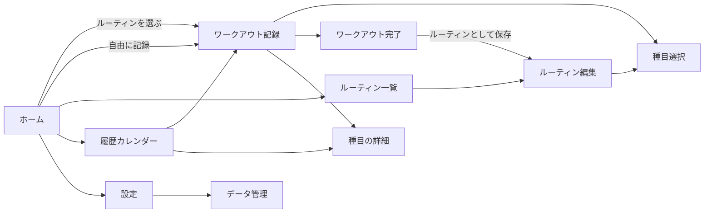
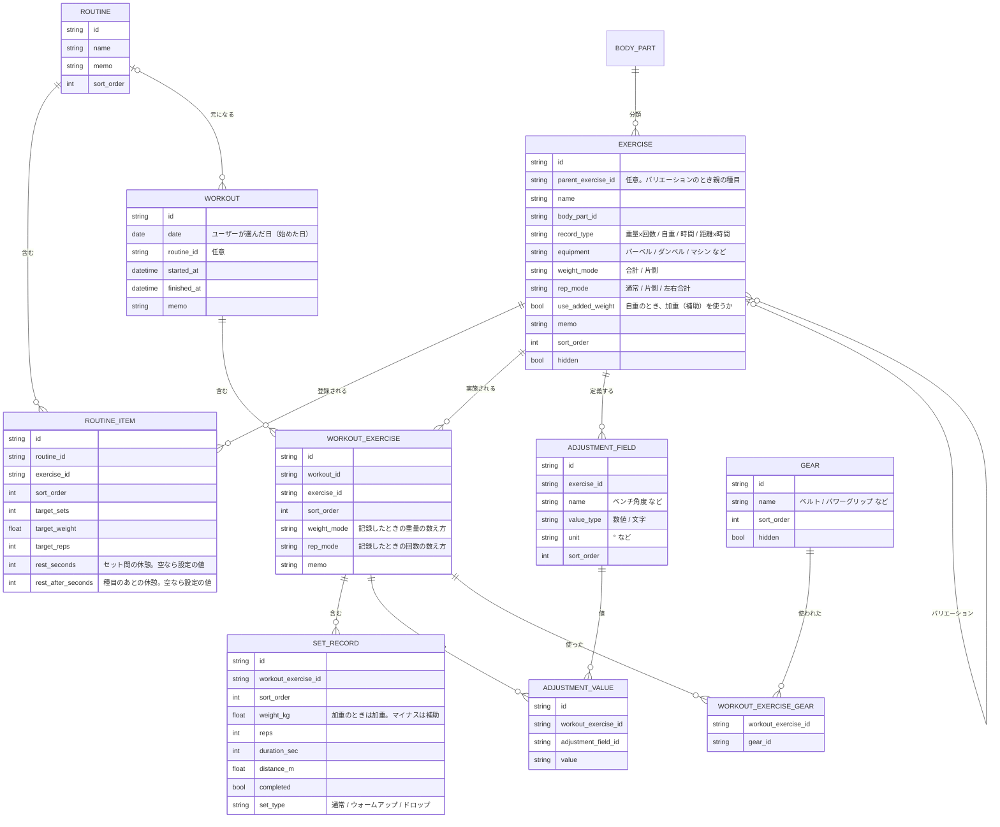
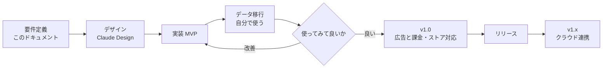

# 要件定義書（v1.7）

> 仮称: **training-log**（アプリ名は未定。ディレクトリ名も名称決定後に変更する）
> 作成日: 2026-11-12 / 更新日: 2026-11-15
> ステータス: 確定。デザイン工程（Claude Design）に渡す。アプリ名（Q-03）は公開前に決めればよい。変更するときは版を上げ、変更点をコミットメッセージに残す。
> v1.1（2026-11-15）: 自重の加重、セットの増減、0.25 kg 刻み、ホームの日付の帯の設定、書き出し案内の移動を反映した。
> v1.2（2026-11-15）: ホームは、読むだけの情報を上、操作するものを下に置く。
> v1.3（2026-11-15）: 記録画面から、種目のこれまでの記録を開けるようにした。今日以外の日付でも、ふつうの記録ができるようにした。ルーティンで休憩（セット間・種目のあと）を決められるようにした。v1.2 で入れた「種目選択に前回の記録を出す」は取り消した。
> v1.4（2026-11-15）: 「セットを足す」を、一覧の中の行ではなく、下のパネルの「＋セット」ボタンにした。
> v1.5（2026-11-15）: ホームに、次のルーティンの中身（種目ごとの前回の記録と、予定のセット数）を、読むだけで出すようにした。余白を広くとり、ほかの表示や下のボタンと同じ内容を重ねない。
> v1.6（2026-11-15）: 設定に「1日の区切り」（初期値 4:00）を加えた。区切りより前の時刻は前の日として扱うので、夜中に始めた記録は、日付を選び直さなくても前の日になる。
> v1.7（2026-11-15）: 実装の開始に合わせて、対応する Android の下限（8.0）と、データモデルの実装上の違い（6.1 の下の注）を書いた。

---

## 1. 背景と目的

### 1.1 背景

- 現在は既存の筋トレ記録アプリ（以下「現行アプリ」）で記録している。
- 現行アプリの良いところは **UI がシンプル** なことと **買い切りで安い** こと。ログインもクラウドも使わない作りで、この価格を実現していると考えられる。
- 一方で **ルーティン（メニューのテンプレート）を登録できない** ことと、**UX に好みでない部分がある** ことが不満。
- 現在の利用端末は **Android**。

### 1.2 現行アプリの不満点と、このアプリでの解決

| # | 不満 | 解決する要件 |
|---|------|--------------|
| P-1 | ルーティンを登録できない | 4.2 ルーティン（F-RT-*） |
| P-2 | 登録した種目の順番変更がスムーズにいかない | どの一覧も長押しドラッグで並べ替える（F-UI-01） |
| P-3 | 一度画面を閉じると、次のセットを入力するのに＋ボタンを押す必要がある | 種目を開いた時点で次のセットが前回値入りで用意されている（F-WO-03） |
| P-4 | 記録した重量が片手の重さか両手の合計か分からない | 種目ごとに重量の数え方（片側 / 合計）を持ち、記録の横に必ず表示する（F-EX-08） |
| P-5 | ダンベルかバーベルか分からない | 種目に器具の属性を持たせ、一覧と記録画面に表示する（F-EX-09） |
| P-6 | ベンチ台の角度などを入力できない | 種目ごとに調整項目（ベンチ角度、シート位置など）を定義し、記録ごとに値を残す（F-EX-10, F-WO-12） |

### 1.3 目的

1. 自分が毎日使える筋トレ記録アプリを作る（第一のユーザーは自分）。
2. 現行アプリから記録データを移して乗り換える。
3. 使ってみて良ければ、App Store / Google Play で公開する。

### 1.4 基本方針（この4つは全工程で守る）

| 方針 | 内容 |
|------|------|
| **サーバーを持たない** | ログイン・アカウント・自前のクラウド保存を作らない。データはすべて端末内にだけ置く。 |
| **個人情報を持たない** | メールアドレス・決済情報・氏名などを受け取らない、保存しない。決済は OS のストアに任せる。 |
| **パクらない** | 機能の考え方は参考にしてよいが、画面構成・見た目・文言・名称は自分で一から決める（詳細は「10. 既存アプリとの差別化と模倣の回避」）。 |
| **とことん軽く** | アプリのサイズ、起動の速さ、電池の消費を最優先する。機能や依存ライブラリを足すときは、軽さを損なわないかを先に考える。収益は目的にしない。 |

---

## 2. 対象ユーザー

| 区分 | 想定 |
|------|------|
| 主ユーザー | 自分。ジムでフリーウェイト・マシン中心に週数回トレーニングする。 |
| 公開後のユーザー | 「シンプルに記録だけしたい」「アカウント登録は面倒」「サブスクは嫌」という人。 |
| 利用シーン | ジムでセットの合間に片手で入力する。汗をかいている、時間がない、画面をじっくり見ない。 |

---

## 3. スコープ

### 3.1 リリース段階

| 段階 | 内容 | 目的 |
|------|------|------|
| **MVP**（自分用・Android） | 記録・ルーティン・履歴・グラフ・タイマー・ファイルでのバックアップ・乗り換え用の初期設定 | 現行アプリから乗り換えられる状態にする |
| **v1.0**（公開） | MVP ＋ 広告 ＋ 広告削除の購入 ＋ ストア公開に必要な対応 | 公開する |
| **v1.x**（後追い） | 体重の記録、ユーザー自身のクラウドストレージ（Google ドライブ / iCloud）へのバックアップ連携 など | 記録の幅を広げる。データ消失が不安な人向け |

### 3.2 やらないこと（スコープ外）

- ログイン、アカウント、自前のサーバー・データベース
- SNS 機能（フレンド、共有タイムライン、ランキング）
- AI によるメニュー提案・コーチング
- 食事の管理、体重以外の体組成の詳細管理（体重の記録は v1.x で入れる）
- Web 版・タブレット専用レイアウト
- 多言語対応（日本語のみで始める。ただし後から英語を足せる作りにはしておく）

---

## 4. 機能要件

優先度: **Must** = MVP に必須 / **Should** = v1.0 までに入れたい / **Could** = 余裕があれば・後回し

### 4.1 種目の管理

| ID | 要件 | 優先度 |
|----|------|--------|
| F-EX-01 | 初回起動時に代表的な種目をプリセットとして用意する（種目名・説明文は自分で作成する） | Must |
| F-EX-02 | 種目を追加・名前変更・削除（非表示）できる | Must |
| F-EX-03 | 種目を部位（胸・背中・脚・肩・腕・腹・全身・有酸素 など）で分類できる | Must |
| F-EX-04 | 種目ごとに記録の種類を選べる: 「重量×回数」「自重（回数）」「時間」「距離×時間」 | Must |
| F-EX-05 | 過去の記録がある種目を削除するときは、記録を残したまま非表示にする | Must |
| F-EX-06 | 種目名で検索できる | Should |
| F-EX-07 | 種目にメモ（フォームの注意点など）を書ける | Should |
| F-EX-08 | 種目ごとに **重量の数え方** を持つ: 「合計」（バーベル・マシンなど）か「片側」（ダンベル・片手ずつのケーブルなど）。記録画面・履歴・グラフでは数値の横に必ず「片手」「合計」を表示する（P-4） | Must |
| F-EX-09 | 種目ごとに **器具** を持つ: バーベル / ダンベル / マシン / ケーブル / スミスマシン / ケトルベル / 自重 / その他。種目一覧と記録画面にアイコンや文字で表示し、器具で絞り込める（P-5） | Must |
| F-EX-10 | 種目ごとに **調整項目** を定義できる。例: 「ベンチ角度（°）」「シート位置」「グリップ幅」。項目名と、数値か文字かを決められる（P-6） | Must |
| F-EX-11 | 似た種目は次の 3 通りで分けられ、どれを使うかはユーザーが決める。①**別の種目**: 器具が違う（ダンベルベンチプレス / バーベルベンチプレス）。②**バリエーション**（F-EX-14）: 同じ種目のフォーム違い（ワンハンドダンベルロウの「膝をベンチにつく」/「立って背もたれに手をつく」）。③**調整項目**（F-EX-10）: 数値で表せる違い（ベンチ角度 0° / 30° / 45°） | Must |
| F-EX-12 | 器具がバーベルの種目では、バーの重さを含めた重量で記録する（含めるかどうかは設定で変えられる） | Could |
| F-EX-13 | 種目ごとに **回数の数え方** を持つ: 「通常」（両手・両脚を同時に動かす）/「片側」（片側ずつ行い、片側の回数を入れる）/「左右合計」（左右の回数を足して入れる）。記録画面・履歴・グラフでは回数の横に「片側」「左右計」を表示する（重量の数え方 F-EX-08 と同じ考え方） | Must |
| F-EX-14 | 種目の下に **バリエーション**（フォーム違い）を作れる。入れ子は「親の種目 → バリエーション」の 2 段まで | Must |
| F-EX-15 | バリエーションは、作ったときに親の部位・器具・重量と回数の数え方・調整項目を引き継ぐ。その後は個別に変えられる（親を変えてもバリエーションには反映しない） | Must |
| F-EX-16 | 記録はバリエーションごとに残る。前回の記録と次のセットの初期値は同じバリエーションから取る。初めて使うバリエーションなら、同じ親のほかのバリエーションの直近の記録を、どのバリエーションかを添えて表示する | Must |
| F-EX-17 | 種目選択では、親の種目の下にバリエーションを折りたたんで表示する | Must |
| F-EX-18 | 記録がすでにある種目に後からバリエーションを作ったとき、それまでの記録を選んだバリエーションへまとめて移せる | Should |
| F-EX-19 | 記録の種類が「自重（回数）」の種目では、**加重を使うか** を選べる（ウェイトベスト・ディップベルトなど）。使うと、重量の欄が「加重（kg）」になる。0 のときは「自重」と表示し、マイナスの値は「補助」（アシストマシンなど）として扱う。記録・履歴・グラフでは、数値の横に「加重」「補助」を表示する | Must |

### 4.2 ルーティン（現行アプリにない機能。このアプリの主役）

| ID | 要件 | 優先度 |
|----|------|--------|
| F-RT-01 | ルーティン（例: 「胸の日」「Push」「Day A」）を作成・編集・削除できる | Must |
| F-RT-02 | ルーティンに種目を登録し、順番をドラッグで並べ替えられる（F-UI-01） | Must |
| F-RT-03 | ルーティン内の種目ごとに目標（セット数、重量、回数）を設定できる。空欄でもよい | Must |
| F-RT-04 | ルーティンを選ぶだけで、その日のワークアウトを開始できる（種目と目標セットが展開される） | Must |
| F-RT-05 | 開始後もその日だけ種目の追加・削除・入れ替え、セット数の増減ができ、元のルーティンは変わらない | Must |
| F-RT-06 | 終わったワークアウトを「ルーティンとして保存」できる。ルーティンから始めて内容を変えた日は、「今日の内容をルーティンに反映する」も選べる | Should |
| F-RT-07 | 次にやるルーティンを提案する（例: A → B → C の順番で回す、前回の続きを表示） | Should |
| F-RT-08 | ルーティン内の種目ごとに、セット間の休憩時間を決められる。空欄なら、設定の休憩時間を使う。タイマーに反映される | Should |
| F-RT-09 | スーパーセット（2種目を交互に行う）をまとめて扱える | Could |
| F-RT-10 | ルーティンには親の種目もバリエーションも登録できる。親を登録した場合は、ワークアウト中にバリエーションを選ぶ（初期値は前回使ったもの） | Should |
| F-RT-11 | ルーティンにメモを書ける（例: 「ベンチが空いていなければダンベルプレスに変更」）。ルーティンから始めたワークアウトでは、記録画面でこのメモを見られる。ルーティン内の種目ごとのメモは持たず、ここにまとめて書く | Should |
| F-RT-12 | ルーティン内の種目ごとに、種目のあとの休憩時間（次の種目に進むまで）も決められる。空欄なら、設定の「休憩（種目のあと）」を使う | Should |
| F-RT-13 | ホームに、次のルーティンの中身を、読むだけで出す。出すのは、種目名・前回の記録（日付・重量・回数）・予定のセット数。前回の記録がない種目は、前回の行を出さない。行は最大 3 行にして、3 種目までは全部、4 種目以上は先頭の 2 種目と「ほか N 種目」にする。見出しに、ルーティンの並び（F-RT-07）を入れる。「前回のワークアウト」や、下の開始ボタンと同じ内容は、重ねて出さない。画面が低い端末では、この部分だけスクロールさせ、日付の帯と開始ボタンは下に固定する | Should |

### 4.3 ワークアウトの記録

| ID | 要件 | 優先度 |
|----|------|--------|
| F-WO-01 | 日付ごとにワークアウトを記録できる。ルーティンなしの自由記録も可能 | Must |
| F-WO-02 | 種目ごとにセット（重量・回数など）を追加・編集・削除できる（追加と削除の操作は F-WO-16 / F-WO-17） | Must |
| F-WO-03 | 種目を開いた時点で **次のセットの入力行が常に用意されている**。値は直前のセット（その日の最初のセットなら前回の同じ種目）で埋まっていて、そのまま「完了」を押せば記録できる。画面を閉じて開き直しても同じ（P-3） | Must |
| F-WO-04 | 入力中の種目について、**前回の同じ種目の記録** を同じ画面に表示する | Must |
| F-WO-05 | 重量・回数は、大きめのボタン（±）と、数字をタップして開く数値キーボードの両方で入力できる。キーボードでは小数（0.25 など）も直接入力できる | Must |
| F-WO-06 | セットに「完了」チェックを付けられる。ルーティンの目標セットは未完了状態で並ぶ | Must |
| F-WO-07 | 入力はすぐ端末に保存され、アプリが落ちても入力済みの内容が消えない | Must |
| F-WO-08 | ワークアウト全体と種目ごとにメモを書ける。セットごとのメモは持たず、種目ごとのメモに書く（例: 「3セット目でフォームが崩れた」） | Should |
| F-WO-09 | セットに種類の印を付けられる（ウォームアップ、ドロップセット など） | Could |
| F-WO-10 | 体感の強度（RPE や「余裕あと何回」）を記録できる | Could |
| F-WO-11 | 過去日の記録を後から追加・修正できる | Must |
| F-WO-12 | 調整項目（F-EX-10）の値をワークアウトごとに記録できる。初期値は前回の値で、変えなければ入力不要（P-6） | Must |
| F-WO-13 | その日のワークアウト内の種目の順番を、長押しドラッグで並べ替えられる | Must |
| F-WO-14 | 記録中に、その種目の重量・回数の数え方をその日の記録だけ変えられる（種目の設定は変わらない） | Should |
| F-WO-15 | 左右で回数が違うとき（例: 右 10 回、左 9 回）に、左右を別々に入力できる | Could |
| F-WO-16 | 下のパネルに「＋セット」ボタンがあり、いま選んでいる種目にセットを足せる。足したセットは、直前のセットの値で用意される。ルーティンの目標セット数より多くても少なくてもよい | Must |
| F-WO-17 | セットは、行を左にスワイプして削除できる（完了したセットも消せる）。直後に取り消せる（F-UI-03） | Must |
| F-WO-18 | ワークアウトを終えるとき、未完了のセット（目標のまま残した行）は記録に含めない | Should |
| F-WO-19 | ± ボタンは、押し続けると速く増減する | Should |
| F-WO-20 | ワークアウトの日付を選べる。今日以外の日付でも、ふつうの記録画面（休憩タイマーつき）で記録できる（例: 土曜の 24 時を過ぎてから、土曜日のトレーニングとして記録する）。日付は、始めるときと、記録中にも変えられる。今日以外のときは、画面の上に日付を出す | Must |
| F-WO-21 | 今日以外の日付では、タイマーなしの簡易入力（あとから入力）も選べる。記録中でも、ふつうの記録と行き来できる | Should |
| F-WO-22 | 日付をまたいで続けたワークアウト（0 時や、1日の区切りの時刻を過ぎても記録中）は、始めた日の日付のままにする | Must |
| F-WO-23 | 「今日」は、1日の区切り（F-SE-08）に従う。区切りの時刻より前にワークアウトを始めると、日付の初期値は前の日になる（例: 区切りが 4:00 のとき、日曜の 1:30 に始めた記録は土曜になる）。ホームの日付の帯と履歴カレンダーの「今日」の印も、この「今日」を基準にする。日付は F-WO-20 のとおり、あとから変えられる | Should |

### 4.4 ギア（ベルト・パワーグリップなど）

| ID | 要件 | 優先度 |
|----|------|--------|
| F-GR-01 | ギアの一覧を持つ。プリセットはベルト、パワーグリップ、リストストラップ、リストラップ、ニースリーブ、エルボースリーブ。追加・名前変更・非表示・並べ替えができる | Must |
| F-GR-02 | 記録画面で、種目ごとに使ったギアを、チップ（小さなボタン）をタップするだけで付け外しできる | Must |
| F-GR-03 | 初期値は前回その種目で使ったギア。いつも同じギアなら入力は要らない | Must |
| F-GR-04 | 履歴・種目の詳細で、記録の横に使ったギアを表示する | Must |
| F-GR-05 | セットごとにギアを付け外しできる（例: 重いセットだけベルトを巻く） | Could |
| F-GR-06 | グラフで、ギアを使った記録に印を付ける。ギアのあり・なしで絞り込める | Could |

### 4.5 インターバルタイマー

| ID | 要件 | 優先度 |
|----|------|--------|
| F-TM-01 | セットを完了にすると休憩タイマーが自動で始まる（自動開始はオン/オフ可） | Must |
| F-TM-02 | 休憩時間の初期値を設定でき、実行中に ±で延長・短縮できる | Must |
| F-TM-03 | 時間になったら音・バイブレーションで知らせる。アプリがバックグラウンドでも通知で知らせる | Must |
| F-TM-04 | タイマーは記録画面を邪魔しない（記録を続けながら残り時間が見える） | Must |
| F-TM-05 | 休憩の長さは、完了したセットで決まる。種目の最後のセットを完了して次の種目に進むときは「種目のあとの休憩」、それ以外は「セット間の休憩」を使う。どちらも、ルーティンの種目に設定があればそれを、なければ設定の初期値を使う | Should |

### 4.6 履歴

| ID | 要件 | 優先度 |
|----|------|--------|
| F-HI-01 | カレンダーで、トレーニングした日と鍛えた部位がひと目で分かる | Must |
| F-HI-02 | 日付を選ぶとその日の記録を見られる・編集できる | Must |
| F-HI-03 | 種目ごとの過去の記録を新しい順に一覧できる | Must |
| F-HI-04 | 過去のワークアウトをコピーして今日のワークアウトを始められる | Should |
| F-HI-05 | ホームの日付の帯で日付をタップすると、その日のワークアウトを開く。記録がない日なら、ルーティンと記録のしかた（ふつうに記録 / あとから入力）を選んで、その日の記録を新しく始める（夜中に前日の分を入れるときなど）。帯の並びは F-SE-06 で選ぶ | Must |
| F-HI-06 | ホームの日付の帯は、左右にスワイプして前後の日へ動かせる。「今日」へ戻れる | Should |
| F-HI-07 | 記録画面の種目の見出し（名前と前回の記録）と、下のパネルの種目名をタップすると、その種目の詳細（これまでのすべての記録とグラフ）を開ける。戻ると、記録中の画面にそのまま戻る。記録中に開いたときは、広告を出さない | Must |

### 4.7 グラフ・統計

| ID | 要件 | 優先度 |
|----|------|--------|
| F-ST-01 | 種目ごとに、最大重量の推移をグラフで見られる（加重のある自重の種目は最大加重、加重のない自重の種目は最大回数） | Must |
| F-ST-02 | 種目ごとに、推定 1RM（最大挙上重量の推定値）とボリューム（重量×回数の合計。片側の種目の計算は 6.2）の推移を見られる | Should |
| F-ST-03 | 自己ベストを更新したセットに印を付ける | Should |
| F-ST-04 | 期間（1か月 / 3か月 / 1年 / 全期間）を切り替えられる | Should |
| F-ST-05 | 週や月ごとのトレーニング回数・部位ごとの量を見られる | Could |
| F-ST-06 | バリエーションのある種目では、バリエーションごとの表示と、親の種目でまとめた表示を切り替えられる | Should |

### 4.8 データの保存・バックアップ・移行

| ID | 要件 | 優先度 |
|----|------|--------|
| F-DA-01 | すべてのデータを端末内のデータベースに保存する | Must |
| F-DA-02 | 全データを 1 つのファイル（JSON）に書き出し、OS の共有機能でメール・ファイルアプリ・クラウドドライブなど好きな場所に保存できる | Must |
| F-DA-03 | 書き出したファイルを読み込んで復元できる。復元前に「上書き」か「取り消し」を確認する | Must |
| F-DA-04 | 記録を CSV で書き出せる（表計算ソフトで見られる形） | Should |
| F-DA-05 | **乗り換え用の初期設定**: 種目ごとに「器具・重量と回数の数え方・直近の重量と回数・自己ベスト」を一覧形式でまとめて入力できる。現行アプリのバックアップは暗号化されていて読み込めない（R-01）ため、まずは手で移す前提にする | Must |
| F-DA-06 | F-DA-05 で入れた直近の値は、初回のワークアウトで「前回の記録」として表示され、次のセットの初期値にも使われる | Must |
| F-DA-07 | **取り込み形式を 1 つ決めて公開する**。アプリは列・項目を定義したこの形式（CSV または JSON）だけを受け付け、現行アプリなど特定アプリの独自構造はアプリに持ち込まない（詳細は 6.3） | Should |
| F-DA-08 | F-DA-07 の形式で、過去の記録を日付付きでまとめて取り込める（グラフに過去の推移を残したい場合用） | Could |
| F-DA-09 | 書き出しの案内は **ホーム画面には出さない**。「設定」の「データ管理」の行と、データ管理の画面で、最後に書き出した日と、そこからの日数を見せる | Should |
| F-DA-10 | 端末内に自動で世代バックアップを残す（直近数回分。データ破損時の復旧用） | Should |
| F-DA-11 | ユーザー自身の Google ドライブ / iCloud にバックアップファイルを保存・復元できる（開発者側はデータを持たない） | Could（v1.x） |

### 4.9 広告と広告削除の購入（v1.0）

収益は目的にしないので、広告は最小限にする。広告のためにアプリの軽さや記録のしやすさを犠牲にしない。

| ID | 要件 | 優先度 |
|----|------|--------|
| F-AD-01 | 無料で全機能を使える。広告を表示する | Should |
| F-AD-02 | 広告は **記録中の画面には出さない**。履歴・グラフ・設定などの画面の下にバナーを出すだけにする | Should |
| F-AD-03 | 画面全体を覆う広告（インタースティシャル）や動画広告は使わない | Should |
| F-AD-04 | アプリ内課金（買い切り）で広告を永久に非表示にできる | Should |
| F-AD-05 | 「購入を復元」で、機種変更・再インストール後も広告非表示を戻せる | Should |
| F-AD-06 | 購入は App Store / Google Play の仕組みだけで行い、アプリはメールアドレスや決済情報を一切受け取らない | Should |
| F-AD-07 | 広告の仕組み（SDK）は、広告を出す画面を初めて開いたときに読み込む。起動と記録画面を遅くしない。広告削除を購入した人には一切読み込まない | Should |

### 4.10 操作全般

| ID | 要件 | 優先度 |
|----|------|--------|
| F-UI-01 | 並べ替えられる一覧（種目、ルーティン、ルーティン内の種目、その日のワークアウト内の種目）は、すべて **長押しまたはつまみ（ハンドル）をドラッグ** するだけで並べ替えられる。並べ替え専用の編集モードに切り替えたり、上下ボタンを何度も押したりしなくてよい（P-2） | Must |
| F-UI-02 | ドラッグ中は画面の端に近づくと一覧が自動でスクロールし、長い一覧でも端から端へ動かせる | Must |
| F-UI-03 | 並べ替え・削除（セットの削除も含む）は直後に取り消せる | Must |

### 4.11 設定

| ID | 要件 | 優先度 |
|----|------|--------|
| F-SE-01 | 重量の単位（kg / lb）を切り替えられる | Must |
| F-SE-02 | ±ボタンで増減する重量の刻みを選べる。kg は 0.25 / 0.5 / 1 / 1.25 / 2 / 2.5 / 5、lb は 0.5 / 1 / 2.5 / 5 / 10。種目ごとに上書きもできる | Must |
| F-SE-03 | ライト / ダーク / 端末に合わせる を選べる | Should |
| F-SE-04 | 履歴カレンダーの週の始まり（日曜 / 月曜）を選べる。初期値は端末の設定に合わせる | Should |
| F-SE-05 | 利用規約・プライバシーポリシー・ライセンス表示を見られる | Should（公開時は必須） |
| F-SE-06 | ホームの日付の帯の並びを選べる: 「その週」（週の始まりに合わせて 7 日）/「今日を真ん中」（前後 3 日ずつ）/「直近 7 日」（今日が右端）。初期値は「その週」 | Must |
| F-SE-07 | 休憩の初期値を 2 つ決められる: 「セット間」と「種目のあと」。記録中に ± で変えることもできる（F-TM-02） | Should |
| F-SE-08 | 1日の区切りの時刻を選べる（0:00〜6:00 を 1 時間刻み。初期値は 4:00）。0:00 から区切りまでの時刻は、前の日として扱う（F-WO-23）。0:00 にすると、日付どおりになる。設定を変えても、記録済みのワークアウトの日付は変わらない | Should |

---

## 5. 画面一覧（デザイン工程への入力）

画面の見た目・配置は Claude Design で決める。ここでは「どんな画面が必要か」と「各画面で何ができるか」だけを決める。

| 画面 | 主な役割 |
|------|----------|
| ホーム（今日） | 今日のワークアウト開始。日付の帯（その週 / 今日を真ん中 / 直近 7 日）から、その日の記録を開く。次のルーティンの提案と中身（種目ごとの前回の記録・予定のセット数）、前回のワークアウトの要約。記録がない過去の日は、記録のしかた（ふつうに / あとから入力）を選ぶ。書き出しの案内は出さない |
| ルーティン一覧 | ルーティンの一覧・並べ替え・作成 |
| ルーティン編集 | 種目の追加・並べ替え、目標の設定（セット数・重量・回数・休憩）、メモ |
| 種目選択 | 部位・器具で絞り込み・検索して種目を選ぶ。バリエーションは親の下に折りたたんで表示。新しい種目の追加 |
| 種目の編集 | 名前・部位・記録の種類（自重のときは加重を使うか）・器具・重量の数え方（片側 / 合計）・回数の数え方・調整項目の定義、バリエーションの追加 |
| ワークアウト記録 | セットの入力・完了・追加・削除、前回の記録の表示、ギアの付け外し、休憩タイマー、日付の表示、種目の詳細（これまでの記録）への入口。**最重要画面** |
| ワークアウト完了 | その日の要約（種目数、ボリューム、自己ベスト）、ルーティンとして保存 |
| 履歴（カレンダー） | 月のカレンダーと、選んだ日の記録 |
| 種目の詳細 | 種目ごとの履歴一覧とグラフ、メモ、前回の調整項目の値。記録中の画面からも開ける |
| データ管理 | 書き出し・読み込み、乗り換え用の初期設定、取り込み形式（F-DA-07）のファイルの取り込み |
| 設定 | 単位・刻み（0.25 kg から）・テーマ・週の始まり・1日の区切り・ホームの日付の帯・休憩（セット間 / 種目のあと）・ギアの管理・広告削除の購入と復元・規約 |

### 5.1 UX の原則

1. **片手・数タップ**: 1 セットの記録は「値の確認 → 完了をタップ」の 1 タップで済むのが理想。
2. **前回が見える**: 何kgで何回やったかを思い出すために画面を移動させない。
3. **大きいタップ領域**: 汗をかいた指でも押し間違えない。主要ボタンは画面の下半分に置く。
4. **消えない安心感**: 保存ボタンを押さなくても入力した瞬間に保存される。削除は取り消せる。
5. **静か**: 記録中に広告・ポップアップ・お知らせで邪魔をしない。
6. **下だけで完結**: 入力と、よく使う操作（種目の切り替え・完了・休憩の延長・ギアなど）は、画面の下半分だけで届くようにする（親指だけで操作できる）。前回の記録のような読むだけの情報は上に、操作するもの（開始ボタン、日付の帯など）は下に置く。

---

## 6. データ要件

### 6.1 データモデル（概要）

> **実装上の違い（Android 版）**: ER 図は概要で、実装では次のように持つ。①部位（`BODY_PART`）は表でなく列挙型にする（利用者が部位を足す要件はないため）。②ワークアウトの種目（`WORKOUT_EXERCISE`）に、休憩時間（`rest_seconds` / `rest_after_seconds`）を、ルーティンの種目から複写して持つ（ルーティンを後から変えても、記録中の休憩が変わらないように）。③種目（`EXERCISE`）に、その種目だけの重量の刻み（`weight_step_kg`）を持てる（F-SE-02）。④設定は、キーと値の組（`setting` 表）で持つ。⑤調整項目（`ADJUSTMENT_FIELD` / `ADJUSTMENT_VALUE`）は、実装するときに表を足す。

### 6.2 データの扱い

- 重量は内部ではすべて kg で持ち、表示のときに単位を変換する。0.25 kg 刻みの値を誤差なく扱い、入力した値がそのまま表示される（kg と lb を切り替えても、丸めで 0.01 ずれた値にならない）。
- ワークアウトの日付は、始めるときに選んだ日（初期値は「今日」。「今日」は 1日の区切り（F-SE-08）で決まる）。0 時や区切りの時刻を過ぎても、始めた日のままにする。開始・終了の時刻は、実際の時刻を持つ。区切りの設定を変えても、記録済みの日付は変えない。
- 重量と回数は **入力したとおりの値**（片側の種目なら片手の重さ、片側の回数）で保存し、重量の数え方（`weight_mode`）・回数の数え方（`rep_mode`）と組で解釈する。
- 数え方は、記録したときの値をワークアウトの種目（`WORKOUT_EXERCISE`）にも保存する。種目の設定を後から変えても、過去の記録の数値と「片手」「片側」などの表示は変わらない。
- ボリューム（重量×回数の合計）は、実際に動かした量になるように次のとおり計算する。

| 重量の数え方 | 回数の数え方 | ボリューム | 例 |
|--------------|--------------|------------|-----|
| 合計 | 通常 | 重量 × 回数 | バーベルベンチプレス |
| 片側 | 通常 | 重量 × 2 × 回数 | ダンベルベンチプレス（両手同時） |
| 片側 | 片側 | 重量 × 回数 × 2 | ワンハンドダンベルロウ（片側の回数を入れる） |
| 片側 | 左右合計 | 重量 × 回数 | ワンハンドダンベルロウ（左右の回数を足して入れる） |
| 合計 | 片側 | 重量 × 回数 × 2 | 片脚ずつのマシン（片側の回数を入れる） |
| 合計 | 左右合計 | 重量 × 回数 | 片脚ずつのマシン（左右の回数を足して入れる） |
| 加重（自重の種目） | 通常 | 加重 × 回数（体重は含めない） | ウェイトベストを着けたディップス |

- 自重の種目の加重は、重量（`weight_kg`）に入れる。0 は自重、マイナスは補助。マイナスのままでも「数値が大きいほど良い」が成り立つので、自己ベストとグラフは同じ扱いにできる。体重の記録（v1.x）が入ったら、ボリュームに体重を含めるかを選べるようにする。
- 自己ベストは最大重量で決める。加重のある自重の種目は最大加重、加重のない自重の種目は最大回数で決める。
- バリエーションは種目（`EXERCISE`）の一種として持ち、`parent_exercise_id` で親を指す。親の種目にも記録を付けられる（バリエーションを作る前の記録や、フォームを分けない日の記録）。
- ギアは種目ごとの記録（`WORKOUT_EXERCISE`）に付ける。セットごとのギア（F-GR-05）は、入れるときにデータモデルに足す。
- ID は UUID にする（将来、別の端末やクラウドのバックアップと突き合わせるときに番号がぶつからないように）。
- データベースの構造を変えるときは、バージョン番号を付けて古いデータを自動で移し替える（マイグレーション）。
- 書き出しファイルには「どのバージョンの形式か」を入れ、古い形式も読み込めるようにする。

### 6.3 取り込みと移行の分離（設計方針）

アプリ本体と「現行アプリからの移行」を切り離す。

- **アプリが受け付けるのは、列・項目を定義した取り込み形式（F-DA-07）だけ**。現行アプリの独自構造を知る必要はなく、アプリにその知識を持ち込まない。
- 新アプリのデータモデル（6.1）は現行アプリに合わせず、このアプリの要件だけで設計する。現行アプリのモデルを事前に解析する必要はない。
- **現行アプリからの変換は、リポジトリ外に置く使い捨てスクリプトで行う**。読めるソースデータが手に入った時点で、それを取り込み形式に変換する。ソースは問わない（正規の手順で開けたエクスポート、画面から写した記録、別アプリの CSV など）。
- 暗号化された現行バックアップの復号・解析はしない（R-01）。読めるソースが手に入るまで変換スクリプトは作らない。

---

## 7. 非機能要件

| 区分 | 要件 |
|------|------|
| オフライン | 通信なしで全機能が動く（広告の表示と購入だけは通信が必要） |
| 速さ | アプリを開いてから記録画面まで 1 秒以内（目安）。セットの完了タップへの反応は即時 |
| サイズ | ダウンロードサイズは広告の仕組みを含めて 10MB 以下を目安にする。実装の最初に実測して見直す |
| 電池 | 休憩タイマーのために常駐し続けない。バックグラウンドでは OS の通知・アラームの仕組みに任せる |
| データ量 | 毎日記録して 10 年分（数万セット）でも履歴・グラフが重くならない |
| データの安全性 | 書き込みはトランザクションで行い、途中で落ちても壊れない。更新前に自動バックアップ（F-DA-10） |
| 対応 OS | **MVP は Android のみ**（自分の端末）。iOS は v1.0 以降に検討する。対応する Android のバージョンの下限は **Android 8.0（API 26）**（2026-11-15 に決定。内蔵の SQLite が古いので、SQL は 3.18 で動く範囲に絞る） |
| 画面 | スマートフォンの縦向き。文字サイズを大きくする OS 設定に追従する |
| プライバシー | 開発者のサーバーへ記録データを送らない。分析ツール（アクセス解析）も入れない |
| 保守 | 個人で無理なく保守できる構成にする。依存ライブラリは必要最小限 |

---

## 8. 収益化とプライバシーの設計

### 8.1 お金の流れ

- **広告削除はストアのアプリ内課金（非消耗型・買い切り）で実装する。** 支払い・メールアドレス・カード情報はストアが持ち、アプリが受け取るのは「この端末のストアアカウントが購入済みか」という情報だけ。
  - そもそもデジタル機能の販売は、両ストアとも原則としてストアのアプリ内課金を使うルールになっている。
  - 機種変更時は、同じストアアカウントで「購入を復元」すれば戻せるので、アプリ側にアカウントは要らない。
- **購入の検証はサーバーを使わず端末内で行う。** 改ざんして無料で広告を消す人が出る余地は残るが、金額と規模を考えて許容する。
- 手数料: 両ストアとも小規模事業者向けの手数料率（15%）が使える見込み（申請・条件は公開前に確認する）。

### 8.2 「データを持たない」ことの範囲（重要）

アプリ自体は記録データを外に送らないが、**広告を入れると広告の仕組み（例: Google AdMob）が端末の広告 ID などを集める。** そのため、完全に「何も集めない」アプリにはならない。公開前に次の対応が必要。

- プライバシーポリシーを用意し、広告のために何が集められるかを書く
- App Store の「App のプライバシー」、Google Play の「データ セーフティ」に正しく申告する
- iOS ではトラッキングの許可を求めるダイアログ（ATT）に対応する
- 欧州などの利用者向けの同意画面（Google の同意管理の仕組み）に対応する。または配信国を日本に絞るかを決める

「広告削除を購入した人には広告 SDK を一切動かさない」ようにすれば、購入者に対しては本当に何も集めないアプリにできる。これを売りにできる。

### 8.3 ユーザー自身のクラウドへのバックアップ（v1.x）

- 保存先はユーザー自身の Google ドライブ / iCloud。開発者のサーバーは通らない。
- Google ドライブは「このアプリが作ったファイルだけ」にアクセスできる最小の権限で連携する（権限の種類と Google の審査要否は実装前に確認する）。
- iOS は iCloud（ユーザーの Apple アカウント）を使う方法も検討する。
- まずは F-DA-02（ファイル書き出し → 共有機能で好きな場所に保存）で同じことが手動でできるので、連携は後回しでよい。

### 8.4 費用の見込み

| 項目 | 費用 | 備考 |
|------|------|------|
| Apple Developer Program | 年額 99 USD 相当 | iOS も出す場合だけ。毎年かかる |
| Google Play デベロッパー登録 | 25 USD（1 回のみ） | **最初に必要**（Android で公開するため） |
| サーバー代 | 0 円 | サーバーを持たない |
| プライバシーポリシーの置き場 | 0 円 | GitHub Pages などで公開 |

---

## 9. 技術方針

「とことん軽く」（1.4）を最優先に選ぶ。学習コストは考えない。

| 項目 | 採用 | 理由 |
|------|------|------|
| 言語・画面 | **Kotlin ＋ Jetpack Compose**（Android ネイティブ） | JavaScript の実行環境や描画エンジンを同梱しないので、サイズ・起動・メモリが最も小さい。React Native（Expo）や Flutter はこの点で不利 |
| 端末内 DB | SQLite ＋ SQLDelight | SQL から型付きのコードを生成し、実行時の部品が小さい。履歴・グラフの集計を SQL で書ける。Kotlin Multiplatform に対応していて iOS でも使える |
| グラフ | ライブラリを使わず、Compose の Canvas で描く | 必要なのは折れ線と棒くらいなので、依存を増やさない |
| JSON の読み書き | kotlinx.serialization | 実行時の型の解析（リフレクション）を使わず、コード生成で動くので軽い |
| 休憩タイマーの通知 | OS 標準の通知・アラームの仕組み | 常駐し続けない（7 章の「電池」）。具体的な方式は設計時に決める |
| 課金 | Google Play Billing Library を直接使う | 購入管理の外部サービスは開発者側に購入データが残るので使わない |
| 広告 | Google AdMob | 依存の中で最も重いので、遅れて読み込む（F-AD-07） |
| そのほか | DI（依存性注入）のフレームワークなどは使わない | 依存を最小限にする |

- **iOS を出すとき**: 画面は SwiftUI で作り、DB と記録のロジックは Kotlin Multiplatform で Android と共有する。そのため、DB とロジックの層は Android の API に依存させない作りにしておく。

---

## 10. 既存アプリとの差別化と模倣の回避

### 10.1 差別化（このアプリを使う理由）

1. **ルーティンが中心**: 「今日は胸の日」を選ぶだけで記録が始まる。
2. **記録中は広告ゼロ**: 広告は記録以外の画面の控えめなバナーだけ。
3. **何も預けない**: アカウントなし、サーバーなし。購入者には広告 SDK も動かさない。
4. **データは自分のもの**: いつでも JSON / CSV で全部持ち出せる。
5. **後から見ても迷わない記録**: 器具、重量と回数の数え方（片手か合計か、片側か左右合計か）、ベンチ角度、フォームの違い（バリエーション）、使ったギアが記録と一緒に残る。
6. **軽い**: ネイティブで作り、依存を絞る。すぐ開いて、すぐ記録できる。

### 10.2 模倣を避けるためのルール

機能のアイデア（「種目ごとにセットを記録する」「カレンダーで履歴を見る」など）は筋トレ記録アプリに共通するもので、参考にして問題ない。避けるべきは **表現をそのまま写すこと**。以下を守る（法的な判断が必要になったら専門家に確認する）。

- **画面**: 現行アプリのスクリーンショットをデザイン工程（Claude Design）の参考資料として渡さない。要件と UX の原則（5 章）だけを渡す。
- **見た目**: アイコン・配色・イラスト・レイアウトを似せない。
- **名前**: アプリ名は現行アプリと紛らわしくないものにする。ストアの説明文で現行アプリの名前を出さない。
- **文言**: プリセット種目の説明文、ボタンやメッセージの文言は自分で書く。
- **データの取り込み**: 他アプリのバックアップ（暗号化された独自形式）は解析・復号しない。取り込みは、このアプリが公開する取り込み形式（F-DA-07。CSV / JSON）に限る。ストアの説明で他社アプリ名を出して「〇〇から移行できる」と宣伝しない。

---

## 11. 調査事項

| ID | 内容 | いつまでに |
|----|------|------------|
| R-01 | **結果（2026-11-12）**: 現行アプリのバックアップはパスワード付きで暗号化された ZIP で、読み込めない。解析や復号はしない（他アプリが保護している形式を解くことは利用規約に触れるおそれがあり、模倣の回避の方針にも反するため）。データは手で移す（F-DA-05） | 完了 |
| R-02 | **結果（2026-11-13）**: 現行アプリに、バックアップとは別に CSV などで書き出す機能はない。移行は手で行う（F-DA-05）。読めるデータが手に入ったら、取り込み形式（F-DA-07）に変換して取り込む（6.3） | 完了 |
| R-03 | AdMob の導入条件、ATT・同意管理の実装方法、配信国を日本に絞った場合の扱い | v1.0 の実装前 |
| R-04 | 両ストアのアプリ内課金（非消耗型）を端末内だけで検証・復元する方法 | v1.0 の実装前 |
| R-05 | Google Play の新規個人デベロッパー向けのテスト要件（一定人数・一定期間のクローズドテストが必要か）。Android から公開するので早めに確認し、テスターを集める必要があれば準備する | 公開準備の開始時 |
| R-06 | Google ドライブ連携に必要な権限と、Google の審査が要るかどうか | v1.x の着手前 |

---

## 12. 未決事項（決めてほしいこと）

| ID | 内容 | 選択肢・メモ |
|----|------|--------------|
| Q-01 | ~~自分の端末は iOS / Android どちらか~~ | **決定: Android**。MVP と最初の公開は Android。iOS は後で検討 |
| Q-02 | ~~現行アプリで「好みでない」UX は具体的にどこか~~ | **決定**: 1.2 の P-2〜P-6 として反映済み。使いながら気付いたら追記する |
| Q-03 | アプリ名 | 後でよい。ストア公開前に商標検索も行う |
| Q-04 | ~~広告削除の価格~~ | **決定**: 稼ぐことは目的にしないので、安めの買い切り（目安 300 円前後）。広告は最小限（4.9） |
| Q-05 | ~~技術スタック~~ | **決定**: 軽さ優先で Kotlin ＋ Jetpack Compose（9 章） |
| Q-06 | ~~体重の記録を MVP に入れるか~~ | **決定**: MVP には入れない。v1.x で入れる |
| Q-07 | ~~片手ずつ行う種目の回数は、片側の回数か左右の合計か~~ | **決定**: どちらにも対応する。種目ごとに回数の数え方を選べる（F-EX-13） |

---

## 13. 今後の進め方

