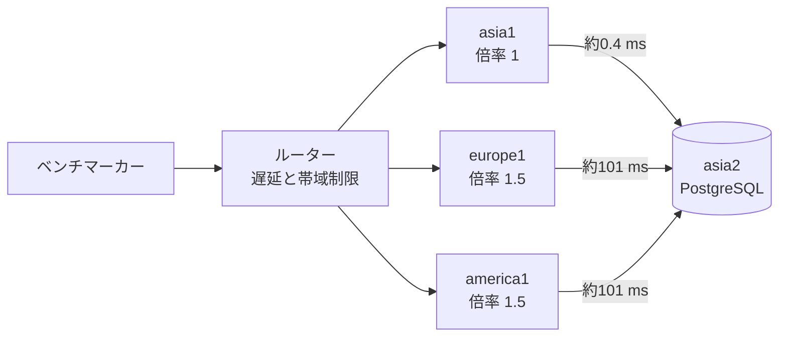
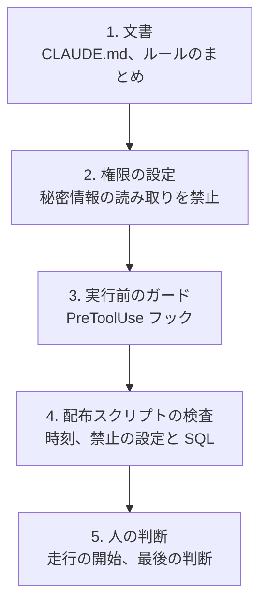
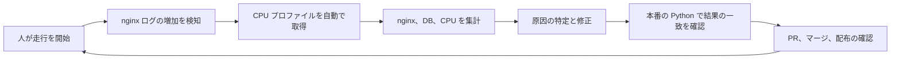

# ISUCON2026 に「パートナーズ」で参加して、Python で 420 位でした

2026年10月31日（土）に開催された ISUCON2026 に、チーム「パートナーズ」（3人）で参加しました。結果は **27,783 点、総合 420 位**、Python の中では **3 位**でした。

この記事では、当日にしたこと、AI（Claude Code）との付き合い方、優勝チームとの差から学んだことをまとめます。

## 結果

| 項目 | 内容 |
|---|---|
| チーム | パートナーズ（3人） |
| 言語 | Python |
| 最終スコア | **27,783 点** |
| 総合順位 | **420 位**（順位表は579位まで。ほかに失格のチームあり） |
| Python の中の順位 | **3 位**（Python は16組） |
| 申告した AI | Claude Code（claude-sonnet-5-5、claude-opus-5-5） |
| スコアの伸び | 記録に残る最初の基準 7,188 点 → 27,783 点（約3.9倍） |

大会全体では、**856 チーム、1,596 人**が参加しました（[参加チーム一覧](https://isucon.net/archives/isucon2026-teams.html)）。

### 上位のチーム

| 順位 | チーム | スコア |
|---:|---|---:|
| 1 | Typing Bears | 625,857 |
| 2 | ゲームセンターヤギ | 475,546 |
| 3 | あとで | 464,395 |
| 4 | 54 | 463,946 |
| 5 | Anago | 452,425 |

出典は[受賞チームと全チームのスコア](https://isucon.net/archives/60126600.html)です。

### 言語別に見ると

[言語別の集計](https://isucon.net/archives/isucon2026-languages.html)では、利用言語の分かった659チームのうち、**Go が 525 チーム（79.7%）**でした。Python は 16 チーム（2.4%）です。

| 言語 | チーム数 | 最高スコア（総合順位） |
|---|---:|---|
| Go | 525 | 625,857（1位） |
| Rust | 50 | 475,546（2位） |
| Node.js | 29 | 95,918（181位） |
| Ruby | 24 | 107,657（152位） |
| **Python** | **16** | **60,719（274位）** |
| PHP | 8 | 56,965（286位） |

Python の上位は次のとおりです。

| Python での順位 | 総合順位 | チーム | スコア | 申告した AI |
|---:|---:|---|---:|---|
| 1 | 274 | pythonista | 60,719 | なし（初期値） |
| 2 | 401 | 大阪といえば串カツ | 30,303 | なし（初期値） |
| **3** | **420** | **パートナーズ** | **27,783** | **Claude Code** |
| 4 | 434 | tomatosalad | 26,130 | なし（初期値） |
| 5 | 437 | ISUCON奮闘チーム | 25,717 | Claude Code、Codex |

AI の利用を申告した Python のチームの中では、私たちが一番上でした。一方、Python の1位は2位以下のほぼ2倍で、Python でもまだ伸ばせたことが分かります。

## どういう問題だったか

お題は写真共有 SNS「ISUReal」でした。投稿期間が始まると利用者は写真を投稿し、友達の写真を見て、コメントや顔写真のリアクション（RealMoji）を送ります。

難しかったのは次の点です。

- **DB は asia2 の1台だけ。** 欧米のサーバーは、SQL を1往復するたびに約0.1秒かかります。
- **画像の本体も DB にある。** DB は 16 GB で、メモリは 3.7 GB です。
- **投稿期間が約9秒で切り替わる。** 期間の終了前にフィードの検証が通らないと加点されません。
- **不正アクセスも来る。** `isureal-guard` というサービスが BAN します。

## 午前中：まず「安全に変更して計測できる状態」を作る

コードを速くする前に、全員が安全に変更して計測できる状態を作りました。

| 時刻 | やったこと |
|---:|---|
| 10:49 | サーバーのコードと設定をリポジトリに取り込み |
| 10:56 | GitHub Actions で Python 実装の自動配布を構築 |
| 11:25 | nginx のログを LTSV 形式に変更 |
| 11:38 | nginx の設定も自動配布 |
| 午前中 | ボトルネックの候補を Issue に整理。根拠と調べ方を各 Issue に記載 |
| 12:14 | alp と pgBadger による集計を Actions から実行できるように整備 |
| 12:20 | Claude Code の指示書とガードを追加 |
| 12:56 | DB の設定とインデックスを配布する仕組みを追加 |

`main` にマージするとアプリと nginx が配布され、DB の変更は手動のワークフローで走行と重ならないように配布します。どの配布も、競技終了の5分前（17:55）を過ぎると実行できないようにしました。

## AI のガードレール

ISUCON は、ルールに違反すると失格になります。そこで、AI の速さより先に、**ルール違反を止める仕組み**を作りました。

Claude Code の `PreToolUse` フックで、コマンドの実行前に内容を検査します。

| 判定 | 例 |
|---|---|
| 常に止める | 外部サービスへの保存、ルーターへのログイン、サーバー間での公開 IP の利用、`/api/initialize` の手動実行、`fsync` の無効化、秘密情報の表示 |
| 人に確認する | `main` への push、マージ、配布、サービスの再起動、DB の変更 |
| 17:45 以降は確認でも通さない | 上の行の操作（ログの停止などは例外） |
| 17:55 以降は止める | `ssh`、`curl`、`git push`、配布 |

試験は114件書きましたが、作ってから見直すと穴がいくつも見つかりました。

- PowerShell を検査していなかった。
- `git status; ssh ...` のように連結すると、後ろのコマンドが素通りだった。
- ガード自体が失敗すると、実行を許可していた（失敗したら止めるように修正）。

また、**人の操作はガードの対象外です。** 13時台に、手順を間違えてインデックスを psql で直接作成してしまいました。実害はありませんでしたが、仕組みだけでは防げないことも分かりました。

## 午後：計測して直す

推測で直さないように、**資源、API、SQL、関数の順に絞り込む**ことを目指しました。

| 調べたいこと | ツール | 分かったこと |
|---|---|---|
| CPU と通信 | Netdata、`sar` | 走行の後半に asia1 の CPU が飽和 |
| API ごとの時間 | nginx の LTSV ログ、alp | どの API が遅いか、asia と欧米の差 |
| SQL ごとの時間 | クエリログ、pgBadger | 画像の取得が DB の時間の 41%。後半はロックを取る SQL が上位 |
| プロセスごとの CPU | `perf` | `gunicorn` が 65%。シンボルの首位は `sha256` |
| **Python の関数ごとの CPU** | **`profiling.sampling`（Python 3.15 の標準機能）** | **`image_signature` が CPU の 52%** |

### スコアの推移

| 時刻 | スコア | 主な変更 |
|---:|---:|---|
| 13時台 | 7,188 | 記録に残っている最初の基準 |
| 13:52 | 8,652 | インデックス8本 |
| 16:24 | 10,905 | Issue ごとの修正をまとめて反映、DB の設定 |
| 16:41 | 13,994 | 署名のキャッシュ、ロックの緩和 |
| 16:55 | 17,723 | ユーザー検索、DB の往復の削減 |
| 17:09 | 21,602 | 署名の高速化、友達の友達の遅延読み込み、クエリログの停止 |
| 17:42 | 27,779 | 署名の C 化、投稿の往復の削減、画像のバイナリ転送 |
| 最終 | **27,783** | 最後の走行 |

**スコアの大半は最後の1時間半で伸びました。** きっかけは、夕方に取った Python の CPU プロファイルです。

### 一番の発見：画像 URL の署名

画像 URL の署名1回で HMAC を1000回計算していて、フィードや Memories では投稿や RealMoji ごとに署名します。Python のプロファイルでは、**CPU の 52% がこの処理**でした。

| 段階 | 変更 | 効果（asia1 の実測） |
|---|---|---|
| 1 | 有効期限をそろえて、同じ画像の署名を再利用 | キャッシュが効く範囲で計算を省略 |
| 2 | HMAC の内部状態を使い回す | 2.35 ms → 1.2 ms |
| 3 | ループを C で実装 | 1.2 ms → 0.5 ms。CPU の割合は 52% → 約30% |

署名の方式と検証結果は変えていません。従来の計算と結果が一致することを本番の Python で確かめ、C のライブラリは読み込み時にも自己試験をして、合わなければ Python に戻るようにしました。

### そのほかの主な修正

| 分類 | 修正 |
|---|---|
| DB | インデックスを8本追加、`shared_buffers` を 1 GB に |
| ロック | 投稿は `FOR UPDATE` から `FOR SHARE` へ。登録時のテーブルロックをやめ、一意インデックスで重複を防ぐ。友達申請のロック待ちが 99.4 秒 → 12.2 秒 |
| 欧米の DB 往復 | 閲覧権限の確認を5往復 → 1往復。`BEGIN` と `COMMIT` をパイプラインでまとめる。画像は16進数のテキストからバイナリの転送へ（エクスポートが 1306 ms → 351 ms） |
| アプリ | フィードを SQL で絞って `LIMIT`。ユーザー検索で全件の取得をやめる。通知（SSE）の DB へのポーリングを worker ごとに1つにまとめる |

この結果、asia1 の1走行あたりのリクエストは**約5,500件から約15,000件**に増えました。

### 終盤のループ

終盤は、次の流れを1周5〜15分で回しました。人が行うのは走行の開始だけで、集計、修正、マージ、配布の確認は Claude Code が担当しました。

17:51 に4台を再起動し、環境チェックの合格と、再起動の前後でデータが一致することを確かめて終了しました。

## 優勝チームはどうしていたか

優勝は、[@kawasy](https://x.com/kawasy) さんが**1人で**参加した「Typing Bears」でした。参加記 [ISUCON2026 で優勝しました（当日編）](https://zenn.dev/luvtechno/articles/isucon2026-competition-day)から、印象に残った点をまとめます。

- **Claude Code と Claude Opus 5.5 で、競技中に人が入力した回数は0回。** 負荷走行86回とコミット19回を、すべてエージェントが実行しています。
- **3か月かけてハーネスを準備。** 評価環境で100回以上問題を解かせて改善し、スキル、Playwright によるポータルへのログイン、終了を判断する仕組みなどを用意していました。
- **構成は、メインのセッション1つと、監査役のサブエージェント1つ。** フックが監査役の起動を促し、判断の記録を見直させます。

スコアの推移は、私たちとまったく違いました。

| 時間帯 | Typing Bears | パートナーズ |
|---|---:|---:|
| 10時台 | 16,647（10:26。DB の設定とインデックス） | 配布の仕組みを作っている |
| 11時台 | 506,241（11:22。データをメモリへ、署名の事前計算、nginx の撤去） | 計測の準備 |
| 13時台 | 615,485（13:27） | 8,652（13:52。インデックス） |
| 最終 | 625,857 | 27,783 |

私たちが計測の土台を作っている間に、優勝チームは **11時台に約50万点**に届いていました。

### 私たちの推測との答え合わせ

競技の後、「上位はこうしていそう」という推測を README に書いていました。参加記と比べると次のとおりです。

| 項目 | 私たちの推測 | 優勝チームの実際 |
|---|---|---|
| 言語 | Go や Rust で処理能力を上げる | Go |
| DB | メモリ上のキャッシュなどで問い合わせを大幅に減らす | PostgreSQL をやめ、各サーバーのメモリにデータを持つ。書き込みは asia2 が順番を決めて全サーバーに適用 |
| 画像 | nginx がローカルのファイルを直接返す | 受け取ったサーバーに保存し、ほかのサーバーは必要なときに取得。nginx は撤去して Go が直接受ける |
| 画像の署名 | （私たちは C 化で 0.5 ms まで） | 有効期限を固定して、**事前計算したテーブルで検証** |
| 遠隔リージョン | リージョンごとにデータを持つ | 書き込みの応答を 60 ms 待ち、読み取りは同期を確かめてから返す。asia の応答をあえて遅らせ、倍率の高い欧米に処理能力を回す |

**署名の HMAC が重いことには、私たちも優勝チームも気づいていました。** 違いは、気づいた時刻（私たちは夕方、優勝チームは11時台）と、直し方（1回を速くするか、計算そのものをなくすか）でした。

また、優勝チームでも走行ごとのスコアは 474,987〜629,638 点とばらついていて、個々の変更の効果は言い切れないと書かれていました。最後の走行で止める判断も、残り回数に応じた閾値で決めていたそうです。

## 振り返り

### うまくいったこと

- **午前中に配布と計測を整えたこと。** 終盤に1周5〜15分で回せたのは、この土台があったからです。
- **Issue に根拠と調べ方を書いたこと。** 人でも AI でも、同じ情報から作業を始められました。
- **ルールを先に仕組みにしたこと。** 失格にならずに終えられました。
- **良いスコアの版にタグを付けたこと。** いつでも戻せる安心感がありました。

### 反省

- **CPU の計測が遅かった。** DB の統計から入ったので、署名が CPU の 52% という事実に気づくのが夕方になりました。**最初にアプリのプロファイルを取るべきでした。**
- **優先順位を読み取り行数で決めた。** `users` の全件スキャンを最大の課題と判断しましたが、1回数ミリ秒で、影響は小さいものでした。**実行時間の合計で決めるべきでした。**
- **複数の変更を同時に入れた。** スコアの伸びの内訳が分かりません。
- **構成を変える判断をしなかった。** 優勝チームとの差は約22倍です。既存の構成を少しずつ速くするのではなく、DB を通らない構成へ早い段階で切り替える必要がありました。
- **言語を変えなかった。** Python のまま、どこまで伸ばせるかの判断も持てていませんでした。

### AI について

私たちは「AI がルールを破らないように」ガードを作ることに多くの時間を使いました。優勝チームは、3か月かけて「AI が1人で8時間判断し続けられる」ハーネスを作っていました。

同じ Claude Code と Opus でも、**周りの仕組みの作り込みで結果が大きく変わる**ことを実感しました。ガードレールは失格を防ぐのに役立ちましたが、それだけではスコアは伸びません。次は、計測、判断、構成の変更までを AI に任せられる準備をして臨みたいです。

## 参考

- [ISUCON2026 受賞チームと全チームのスコア](https://isucon.net/archives/60126600.html)
- [ISUCON2026 参加チーム](https://isucon.net/archives/isucon2026-teams.html)
- [ISUCON2026 利用言語比率と言語別TOP10チーム](https://isucon.net/archives/isucon2026-languages.html)
- [ISUCON2026 で優勝しました（当日編）](https://zenn.dev/luvtechno/articles/isucon2026-competition-day)（[@kawasy](https://x.com/kawasy)）
- [「ちゃんと時間をかけてハーネスを作るとこうなるのか」――人間ゼロ介入のAIエージェントがISUCON2026を制した](https://hashout.jp/ai/13728/)
