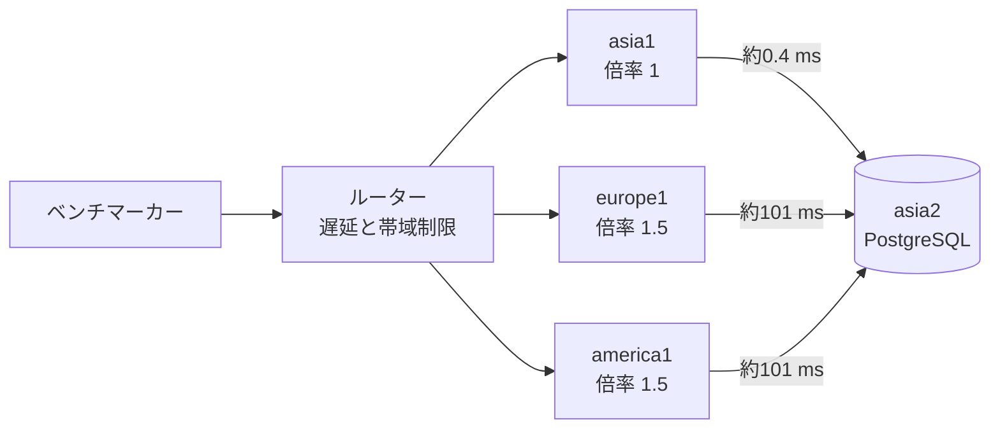

# ISUCON2026 に「パートナーズ」で参加しました（本番 420位、感想戦で作りを変えて36万点）

2026年10月31日（土）の ISUCON2026 に、チーム「パートナーズ」（3人）で参加しました。本番は Python で **27,783 点、総合 420 位**でした。

その後の感想戦では、上位チームの参加記を参考に、データを DB からメモリへ移すなど作りを大きく変え、**363,413 点**まで伸ばしました。言語も Go に移しましたが、移した日の点数は2万〜4万点で、本番と大きくは変わりませんでした。点数が伸びたのは、2日目以降に作りを変えてからです。

本番と感想戦でしたこと、上位チームの参加記から学んだこと、目標の50万点に届かなかった理由をまとめます。

## 結果

| | スコア | 備考 |
|---|---:|---|
| 本番（10/31） | 27,783 | Python。総合420位（856チーム）、Python の中では3位（16チーム） |
| 感想戦（11/7〜11/10） | **363,413** | DB を要求の経路から外す作りに変更（言語は Go）。本番の約13倍 |
| 参考：本番1位 Typing Bears | 625,857 | Go、1人。競技中の人の入力は0回 |
| 参考：感想戦1位（11/10 0時のポータル） | 651,965 | 急須で入れたような何か |

申告した AI は Claude Code（claude-sonnet-5-5、claude-opus-5-5）です。

## どういう問題だったか

お題は写真共有 SNS「ISUReal」でした。投稿期間が始まると利用者は写真を投稿し、友達の写真を見て、コメントや顔写真のリアクション（RealMoji）を送ります。

- **DB は asia2 の1台だけ。** 欧米のサーバーは、SQL を1往復するたびに約0.1秒かかります。
- **画像の本体も DB にある。** DB は 16 GB で、メモリは 3.7 GB です。
- **投稿期間が約9秒で切り替わる。** 期間の終了前にフィードの検証が通らないと加点されません。
- **不正アクセスも来る。** `isureal-guard` というサービスがログを読んで BAN します。

## 本番：Python で 27,783 点

午前中は、全員が安全に変更して計測できる状態を作りました。GitHub Actions による自動配布、nginx の LTSV ログと alp、pgBadger、DB の設定の配布、そして Claude Code のガードです。

ガードは `PreToolUse` フックで、コマンドの実行前に内容を検査します。外部サービスへの保存、ルーターへのログイン、`fsync` の無効化、秘密情報の表示などを止め、`main` への push や配布は人に確認させました。試験は114件書きましたが、PowerShell を検査していない、`;` で連結すると後ろのコマンドが素通りする、などの穴が後から見つかりました。

| 時刻 | スコア | 主な変更 |
|---:|---:|---|
| 13時台 | 7,188 | 記録に残っている最初の基準 |
| 13:52 | 8,652 | インデックス8本 |
| 16:41 | 13,994 | 署名のキャッシュ、ロックの緩和 |
| 17:09 | 21,602 | 署名の高速化、友達の友達の遅延読み込み |
| 最終 | **27,783** | 署名の C 化、投稿の往復の削減、画像のバイナリ転送 |

**一番の発見は画像 URL の署名でした。** 署名1回で HMAC を1000回計算していて、Python の CPU の 52% を占めていました。有効期限をそろえて再利用し、ループを C で書いて 2.35 ms → 0.5 ms にしました。ただ、気づいたのは夕方で、スコアの大半は最後の1時間半で伸びました。

## 上位チームの参加記から

競技の後、上位の参加記を集めて、何をしたら何点になったかを比べました。共通して効いていたのは次の施策です。

| 施策 | 参加記の例 |
|---|---|
| ログインとログアウトを、利用者のリージョンで返す | 3位：237,624 → 464,395 |
| DB を要求の経路から外し、メモリから返す | 1位：16,647 → 139,709 |
| 署名を期限ごとに事前計算する | 1位：139,709 → 388,921（nginx の撤去と同時） |
| JPEG はヘッダーだけ検査する | 1位：388,921 → 483,958 |
| 最終日の通知をリージョンごとにずらす | 1位：それまでの最高 546,385 → 589,550 |
| asia2 もアプリとして使う | 2位：92,537 → 204,650（AVX-512 と同時） |

1位の Typing Bears は、3か月かけて作ったハーネスで、競技中に人が入力した回数が0回でした。11時台には約50万点に届いています。私たちは同じ時間、計測の土台を作っていました。

**署名が重いことには、私たちも1位も気づいていました。** 違いは、気づいた時刻（私たちは夕方、1位は11時台）と、直し方（1回を速くするか、計算そのものをなくすか）でした。

## 感想戦：作りを変えて 363,413 点

感想戦では、自分の AWS アカウントで環境を作り直し、Claude Code に作業を任せました。PR の作成とマージ、配布、ポータルからの負荷走行（Claude in Chrome）まで、人の確認なしで進めます。ルール違反を止めるガードは本番のものを引き継ぎました。

| 日 | その日の最高 | 主な変更 |
|---|---:|---|
| 11/7 | 40,850 | Go へ移植（移植の直後は 20,765 点で、本番の Python と同じくらい）。小さなテーブルをメモリへ |
| 11/8 | 182,970 | 画像の本体を DB から各サーバーのファイルへ。署名を事前計算した表から引く。nginx を外して Go で直接受ける。書き込みの順序を asia2 で決めて全サーバーに適用 |
| 11/9 | 317,494 | 友達関係、セッション、反応の書き込みも順序付けへ。最終日の通知をずらす。asia の Memories を遅らせる |
| 11/10 | 363,413 | Memories とエクスポートを DB から外す。初期画像を投稿者ごとに並べ替える。ログを減らす |

3日目に一番効いたのは、asia1 のディスクでした。エクスポートは利用者の投稿画像を1枚ずつ読むので、ディスクの読み出しの回数の上限（3,000 IOPS）に張り付き、新しい画像の保存（fsync）が平均3.1秒待たされていました。13.7 GB の画像ファイルを投稿者ごとに並べ替え、まとめて読むようにすると、読み出しは毎秒1,673回から624回に、保存は 3.1秒から37ms になりました。

### 50万点に届かなかった理由

- **asia1（2コア）の CPU が、ピークの15〜20秒で張り付いたまま。** その間は書き込みの反映が遅れ、読み取りが平均50〜90ms 待ちます。残りの CPU はフィード、画像の送信、エクスポートに分かれていて、1つで大きく減らせるものはありませんでした。
- **上位の設計を最初にまとめて取り入れなかった。** 本番の作りから少しずつ移したので、DB と同期の仕組みが最後まで残りました。asia2 をアプリとして使う手も試していません。
- **ボトルネックの発見が遅かった。** ディスクの上限や、ログの処理が使う CPU（journald と guard で走行あたり約11秒）は、3日目に OS の計測をして初めて分かりました。それまでは Go のプロファイルばかり見ていました。
- **1回に1つの変更を走行で確かめた。** 1回に10〜20分かかり、点数も走行ごとに ±5% 揺れるので、小さな改善は見分けられませんでした。
- **打ち切りの条件を知らなかった。** 5秒ごとのエラー率が10%を超えると、走行は打ち切られて0点になります。3日目にこれで FAIL して、初めて知りました。

## 実務でも使えるか

点数のためにしたこと（私たちと上位チーム）を、業務システムのような実際のプロダクトでも使えるかで分けました。私たちの見解です。

◎ 実務でもそのまま有用　△ 条件付きで有用　× 競技だからこその対応

| 施策 | 実務 | 性能以外の観点（保守性、セキュリティ） |
|---|:-:|---|
| 計測してから直す（プロファイル、ログの集計、OS の計測） | ◎ | 可観測性そのもの。障害の調査にも役立つ |
| インデックス、SQL の往復の削減、ロックの範囲を狭める | ◎ | 保守性も高い。ロックを緩めるときは整合性の検証が要る |
| 画像の本体を DB の外へ出す | ◎ | 実務ではオブジェクトストレージと CDN に置くのが定石。DB のバックアップも軽くなる |
| データの並びを読み方にそろえる（投稿者ごとに並べる） | ◎ | パーティションやクラスタ化と同じ考え方。作り直しの手順を残す必要がある |
| 配布の自動化、タグで戻せる状態、ルールの機械的な検査 | ◎ | CI/CD とポリシーの検査。AI に任せる範囲の線引きにも使える |
| 署名付き URL のキャッシュ | ◎ | 期限をそろえると同じ URL を長く使えるので、期限の長さとのトレードオフになる |
| ログインを利用者のリージョンで返す | △ | 地域ごとの認証は有用。ログアウトや退会をほかの地域へ確実に伝える仕組みが要る |
| 書き込みの順序を1か所で決め、全サーバーに同じ順で適用する | △ | 分散システムの定石（Kafka、Raft など）と同じ考え方。自前で作ると、障害時の扱いと正しさの保証が重い |
| 言語の変更（Python → Go） | △ | 性能は上がるが、チームの技能と保守の体制しだい。書き直しの危険も大きい |
| ログを減らす | △ | 量の削減やサンプリングは有用。監査や不正の調査に要るログまで削ると危ない |
| 署名を期限ごとに事前計算した表を引く | × | 鍵と期限が固定の前提で、鍵を入れ替えると作り直しになる。HMAC を1000回という重い処理自体が出題の仕掛け |
| DB をやめ、全データを各サーバーのメモリに持つ | × | データ量と台数が固定だから成り立つ。障害時の復旧、データの増加、整合性を自前で抱えることになる |
| nginx を外し、アプリが直接受ける | × | 実務では TLS の終端、WAF、レート制限のために前段を置く。外すと守りが減る |
| JPEG はヘッダーだけ検査する | × | 壊れたファイルや不正なファイルを受け入れることになる。実務では検証を非同期にするなどして、検査自体は残す |
| DB サーバーもアプリとして使う | × | 台数が固定だからの工夫。実務では台数を増やす。同居させると障害の影響範囲が広がる |
| 採点の倍率に合わせ、地域ごとに通知や応答をわざと遅らせる | × | 優先度の制御という考え方は使えるが、利用者の体験をわざと落とすのは競技ならでは |

点数を大きく伸ばした施策ほど、競技の前提（台数とデータ量が固定、採点の仕方が決まっている、ベンチマーカー以外の利用者がいない）に寄りかかっていました。一方で、計測、DB の基本、データの置き方、配布の自動化は、そのまま業務でも使えます。

## 振り返り

### うまくいったこと

- **配布、計測、ガードを先に作ったこと。** 本番は失格せずに終え、感想戦では AI に配布と走行まで任せられました。
- **Issue に根拠と結果を残したこと。** FAIL の原因を後から追えました。

### 反省

- **最初に全体を測る。** 本番は CPU のプロファイル、感想戦はディスクとログを測るのが遅れました。プロセスごとの CPU、ディスク、接続数から見るべきでした。
- **答えのある問題は、設計から真似る。** 参加記がそろっていたのに、少しずつ直す進め方を続けました。
- **安全な変更はまとめて入れ、危ない変更だけを1つずつ確かめる。**
- **期限と打ち切りの基準を最初に決める。** 本番は1日でしたが、感想戦は3日かけても目標に届きませんでした。

### AI について

本番は失格しないためのガードを作り、感想戦では Claude Code に配布と走行まで任せて、スマホから見守りました。優勝チームのハーネスとの違いや、大会で AI を使うことについては、別の記事にまとめました：[AI 時代の ISUCON2026：優勝はハーネス、私たちはガードレール](isucon2026-ai.md)

## 参考

公式：

- [ISUCON2026 受賞チームと全チームのスコア](https://isucon.net/archives/60126600.html)
- [ISUCON2026 参加チーム](https://isucon.net/archives/isucon2026-teams.html)
- [ISUCON2026 利用言語比率と言語別TOP10チーム](https://isucon.net/archives/isucon2026-languages.html)
- [ISUCON2026 関連エントリーまとめ](https://isucon.net/archives/60123473.html)

参加記（順位は本番）：

- 1位 Typing Bears：[ISUCON2026 で優勝しました（当日編）](https://zenn.dev/luvtechno/articles/isucon2026-competition-day)
- 2位 ゲームセンターヤギ：[ichyo さんの記事](https://blog.ichyo.jp/posts/isucon2026)
- 3位 あとで：[mineo さんの記事](https://mineo-engine.com/posts/20261106-isucon2026/)
- 4位 54：[goccy さんの記事](https://goccy54.hatenablog.com/entry/2026/11/03/172808)
- 5位 Anago：[imos さんの記事](https://imoz.jp/scraps/202610_isucon.html)
- 6位 釜中の鯖：[p1ass さんの記事](https://blog.p1ass.com/posts/isucon2026/)
- 8位相当 あとで名前を考える：[yu3mars さんの記事](https://yu3mars.hatenablog.com/entry/2026/11/06/215745)
- 12位 ちゃん：[ponyo877 さんの記事](https://zenn.dev/ponyo877/articles/2a8a24acc2ea3b)
- 13位 GCF：[syfm さんの記事](https://syfm.hatenablog.com/entry/2026/11/03/164654)
- 18位 suekou：[suekou さんの記事](https://dev.classmethod.jp/articles/isucon2026-suekou/)
- 19位 overcached!：[edge2992 さんの記事](https://tech.edge2992.dev/posts/20261102_isucon2026_overcached/)
- 26位 q：[qitoi さんの記事](https://zenn.dev/qitoi/articles/isucon2026-claude-code)
- 29位 もなまっち：[tmokmss さんの記事](https://tmokmss.hatenablog.com/entry/isucon-2026)
- ANT：[1位との差の分析](https://oto-nari.com/posts/isucon2026-ant-retrospective/)
- TAK848：[判断の反省](https://zenn.dev/tak848/articles/20261031-isucon2026-writeup)
- 感想戦 急須で入れたような何か：[人を介さないハーネスの記録](https://zenn.dev/marie673/articles/isucon2026-full-harness)
- [「ちゃんと時間をかけてハーネスを作るとこうなるのか」――人間ゼロ介入のAIエージェントがISUCON2026を制した](https://hashout.jp/ai/13728/)
