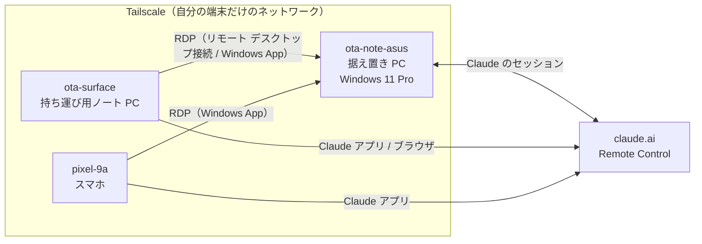
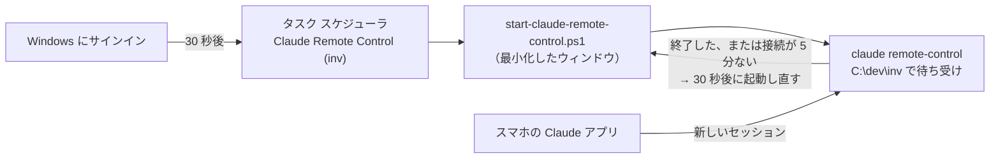

# 据え置き PC にスマホ・ノート PC からリモート接続する（Tailscale + RDP + Remote Control）

## 概要

蓋を閉じて据え置きにしたノート PC に、持ち運び用のノート PC やスマホから接続するための設定メモ。

- 端末どうしは **Tailscale** でつなぐ。ルーターのポートを開けずに、家の外からでも自分の端末だけで閉じたネットワークを作れる
- PC の画面そのものは、**Windows 11 Pro 標準のリモートデスクトップ（RDP）** で操作する。受け付けるのは Tailscale からの接続だけにしてある
- Claude のセッションは **Remote Control** で、スマホやノート PC からそのまま続ける。`claude remote-control` を常駐させてあるので、スマホから新しいセッションも始められる

> このリポジトリは公開されているため、Tailscale の IP アドレス、tailnet 名、アカウントのメールアドレスはここに書かない。
> 必要なときは Tailscale の管理画面（Machines）か、各端末で `tailscale status` を実行して確認する。



## 端末と現在の状態

| 端末 | Tailscale 上の名前 | 役割 | 状態 |
|---|---|---|---|
| 据え置き PC（ASUS Vivobook 16、Windows 11 Pro） | `ota-note-asus` | 接続される側 | Tailscale（無人モード）、RDP 有効（Tailscale からのみ） |
| 持ち運び用ノート PC（Surface） | `ota-surface` | 接続する側 | Tailscale 導入済み |
| スマホ（Pixel 9a） | `pixel-9a` | 接続する側 | Tailscale 導入済み（使うときだけ VPN をオンにする） |

MagicDNS が有効なので、tailnet の中では IP アドレスの代わりに `ota-note-asus` のような名前で接続できる。

## 据え置き PC 側の設定

### 1. 電源設定（蓋を閉じてもスリープしない）

電源につないでいる間は、蓋を閉じても、モニターやキーボードを外してもスリープしないようにしてある。

| 項目 | 電源接続時 | バッテリー時 |
|---|---|---|
| 蓋を閉じたとき | 何もしない | スリープ |
| 自動スリープ | しない | 1 時間 |
| 自動休止状態 | しない | 6 時間 |
| 画面を消すまで | 消さない | 1 時間 |

バッテリー時の設定は、停電やアダプターが抜けたときにバッテリーを使い切らないための守りとしてそのままにしている。
その代わり、**電源が抜けるとスリープしてリモート接続が切れ、蓋を開けるか電源ボタンを押すまで戻らない**。

確認コマンド（PowerShell）:

```powershell
# 蓋を閉じたときの動作（LIDACTION）。AC が 0 なら「何もしない」
powercfg /qh SCHEME_CURRENT SUB_BUTTONS

# 自動スリープ・休止状態の時間。AC が 0 なら「しない」
powercfg /q SCHEME_CURRENT SUB_SLEEP
```

### 2. Tailscale

1. 公式パッケージをインストールする（UAC の確認が出たら「はい」）

   ```powershell
   winget install --id Tailscale.Tailscale -e --source winget
   ```

2. **無人モード**で起動し、表示された URL をブラウザで開いてログインする

   ```powershell
   & 'C:\Program Files\Tailscale\tailscale.exe' up --unattended
   ```

   無人モードにしておくと、Windows からサインアウトしたときや、再起動してまだサインインしていないときでも Tailscale がつながったままになる。据え置き PC では必須。
   あとから切り替える場合は `tailscale set --unattended` でもよい。

3. 確認する

   ```powershell
   $ts = 'C:\Program Files\Tailscale\tailscale.exe'
   & $ts status                  # 端末の一覧と接続状態
   & $ts debug prefs             # "ForceDaemon": true なら無人モード
   & $ts ping -c 3 ota-surface   # 別の端末に届くか
   ```

### 3. Windows 11 Pro へのアップグレード

Home は RDP で接続される側になれないため、Pro にした。

1. BitLocker の回復キーが Microsoft アカウントに保存されているか確認する（https://account.microsoft.com/devices/recoverykey）。Pro にするとドライブの暗号化が BitLocker の扱いになるため
2. 「設定 → システム → ライセンス認証 → Windows のエディションをアップグレード → Microsoft Store を開く」から購入する（約 1.4 万円）
3. 再起動すると Pro になる。アプリやデータはそのまま残る

### 4. リモートデスクトップ（RDP）を Tailscale 限定で有効にする

「ターミナル (管理者)」で次をまとめて実行する。
**ファイアウォールを先に絞ってから RDP を有効にする**ので、Wi-Fi の LAN から接続できる状態が一瞬もできない。

```powershell
# 1. RDP の受け付けを Tailscale のアドレス（100.64.0.0/10, fd7a:115c:a1e0::/48）からだけに制限する
Set-NetFirewallRule -Name RemoteDesktop-UserMode-In-TCP,RemoteDesktop-UserMode-In-UDP,RemoteDesktop-Shadow-In-TCP,RemoteDesktop-In-TCP-WSS -RemoteAddress 100.64.0.0/10,fd7a:115c:a1e0::/48

# 2. RDP を有効にし、ネットワーク レベル認証（接続前にパスワードを確認する仕組み）を必須にする
Set-ItemProperty 'HKLM:\System\CurrentControlSet\Control\Terminal Server' -Name fDenyTSConnections -Value 0
Set-ItemProperty 'HKLM:\System\CurrentControlSet\Control\Terminal Server\WinStations\RDP-Tcp' -Name UserAuthentication -Value 1
Enable-NetFirewallRule -Name RemoteDesktop-UserMode-In-TCP,RemoteDesktop-UserMode-In-UDP

# 3. 「Microsoft アカウント用に Windows Hello サインインのみを許可する」をオフにする
Set-ItemProperty 'HKLM:\SOFTWARE\Microsoft\Windows NT\CurrentVersion\PasswordLess\Device' -Name DevicePasswordLessBuildVersion -Value 0
```

そのあと `Win + L` でロックし、「サインイン オプション」の鍵のアイコンから **Microsoft アカウントのパスワードで一度サインインする**。RDP では PIN や顔認証が使えず、パスワードを PC に覚えさせておく必要があるため。

補足:

- 使わない「シャドウ」（画面を横から見る機能）と WebSocket 経由の規則は、無効のまま同じ範囲に絞ってある
- Tailscale 自身も「Tailscale-In」という規則を作り、この PC の Tailscale アドレス宛ての受信をすべて許可している。tailnet には自分の端末しかないので問題ないが、ほかの人を tailnet に招待するときは Tailscale の ACL で絞る

確認コマンド（PowerShell、管理者でなくてよい）:

```powershell
# 0 なら RDP 有効
(Get-ItemProperty 'HKLM:\System\CurrentControlSet\Control\Terminal Server').fDenyTSConnections

# 規則が有効で、RemoteAddress が Tailscale の範囲になっているか
Get-NetFirewallRule -Name 'RemoteDesktop*' | ForEach-Object {
  [pscustomobject]@{
    Name          = $_.Name
    Enabled       = $_.Enabled
    RemoteAddress = (($_ | Get-NetFirewallAddressFilter).RemoteAddress -join ', ')
  }
}
```

### 5. Claude（Remote Control）

- Claude デスクトップアプリの「新しいセッションを自動で Remote Control につなぐ」をオンにしてある
- セッションは claude.ai/code や Claude アプリ（スマホ）からそのまま続けられる
- 「作業中はスリープさせない」もオン（ただしこれは蓋を閉じたときのスリープは止めないので、上の電源設定が必要）

#### スマホから新しいセッションを始める（`claude remote-control` の常駐）

デスクトップアプリの設定だけでは、PC で始めたセッションを続けることしかできない。
スマホから**新しい**セッションを始めるために、CLI の `claude remote-control` をサインイン時に自動で起動して、`C:\dev\inv` で待ち受けさせている。
待ち受けている間は、スマホの Claude アプリ（Code）にこのフォルダが出て、そこから新しいセッションを始められる。処理は据え置き PC の上で動く。



使っているスクリプト（`scripts/windows/`）:

| ファイル | 役割 |
|---|---|
| `start-claude-remote-control.ps1` | `claude remote-control` を起動し、終了したら 30 秒後に起動し直す。プロセスが残ったままサーバーとの接続が 5 分ない場合も、切れたとみなして起動し直す。`-Stop` で止める。ログは `%LOCALAPPDATA%\ClaudeRemoteControl\launcher.log` |
| `register-claude-remote-control.ps1` | 上をサインイン時に起動するタスクを登録する（管理者権限は不要）。3 日で止まる既定の制限を外し、二重起動しないようにしてある |

初回の準備:

1. CLI でサインインする。**デスクトップアプリとは別にサインインが必要**（未サインインだと `You must be logged in to use Remote Control.` で終了する）

   ```powershell
   claude auth login
   ```

2. タスクを登録して、すぐに起動する

   ```powershell
   pwsh -File C:\dev\inv\scripts\windows\register-claude-remote-control.ps1
   Start-ScheduledTask -TaskName 'Claude Remote Control (inv)'
   ```

3. タスクバーの「Claude Remote Control - C:\dev\inv」のウィンドウを開き、`Enable Remote Control? (y/n)` に `y` と Enter で答える。
   **答えるまでサーバーに登録されず、スマホに出てこない**（アプリには「`claude remote-control` を実行して」と表示される）。
   ウィンドウは最小化で起動するため、この確認が出ていることに気づきにくい。
   答えは `~/.claude.json` に保存される（`remoteDialogSeen`）ので、聞かれるのは最初の 1 回だけ（2026-11-11 に回答済み）
4. ウィンドウに `✔ Connected · inventory · main` と出ればつながっている。スマホの Claude アプリの Code に、`ota-note-asus-...` という名前のセッションが出る

ほかのフォルダでも待ち受けたいときは、フォルダごとにタスクを登録する（1 フォルダにつき 1 プロセス）。
初めてのフォルダは、先に一度 `claude` を起動して「信頼する」を選んでおく。

```powershell
pwsh -File C:\dev\inv\scripts\windows\register-claude-remote-control.ps1 -WorkDir C:\dev\isucon2026 -TaskName 'Claude Remote Control (isucon2026)'
```

> 親フォルダの `C:\dev` で待ち受ければ全リポジトリを 1 つで扱えるが、そのセッションでは各リポジトリの `.claude` の設定（isucon2026 のガードなど）や、`C:\dev\inv` のメモリが読み込まれない。そのため、リポジトリごとに待ち受けている。

止める・確認する:

```powershell
Get-ScheduledTask -TaskName 'Claude Remote Control (inv)'        # State が Running なら動いている
pwsh -File C:\dev\inv\scripts\windows\start-claude-remote-control.ps1 -Stop   # 止める（全フォルダ分。次のサインインでまた起動する）
Start-ScheduledTask -TaskName 'Claude Remote Control (inv)'      # もう一度起動する
pwsh -File C:\dev\inv\scripts\windows\register-claude-remote-control.ps1 -Unregister   # 自動起動をやめる
Get-Content "$env:LOCALAPPDATA\ClaudeRemoteControl\launcher.log" -Tail 20
```

補足:

- スマホから始めたセッションの権限確認（ファイル編集やコマンド実行の許可）は、スマホのアプリに出る。まとめて許可したいときは、`start-claude-remote-control.ps1` の `claude remote-control` に `--permission-mode acceptEdits` などを付ける
- サインインしていないと動かない。再起動のあとは、Windows にサインインするまでスマホから使えない（下の「あとでやること」の自動サインインの設定を参照）
- 止まってしまったときは、RDP で入ってタスクを起動し直す
- `Stop-ScheduledTask` は使わない。タスクが起動したウィンドウ（conhost）だけが閉じて、中の claude が動いたまま取り残される（2026-11-11 に実際に起きた）。取り残されたものは、次に起動したときに自動で止める
- Claude デスクトップアプリは自動で更新され、そのときに再起動する。デスクトップアプリのセッションは、再起動の間だけ Remote Control が切れて、起動後につながり直す。`claude remote-control` の待ち受けは別のプロセスなので影響を受けない

#### PC が再起動したときのセッション

再起動すると、PC で動いていた Claude のセッションはすべて止まる（会話の記録は PC に残る）。

- **`claude remote-control` のセッション**：待ち受けが止まってから**約 4 時間以内**に待ち受けを起動し直すと、止まる前のセッションがすべて戻ってくる（`claude remote-control` の仕様）。待ち受けはサインインの 30 秒後に自動で起動するので、4 時間以内にサインインすれば何もしなくてよい。4 時間を過ぎると戻らず、新しいセッションだけになる
- **4 時間を過ぎたセッション**：会話の記録は残っているので、RDP で入って `C:\dev\inv` で `claude --resume` を実行し、選べば続けられる
- **デスクトップアプリのセッション**：アプリを起動してセッションを開き直すと、同じ claude.ai のセッションにつながり直す。アプリのスタートアップはオフなので、自動では起動しない（「あとでやること」を参照）

実際の記録:

| 日時 | 何が起きたか | セッション |
|---|---|---|
| 2026-11-12 2:29 | Windows Update の再起動。起動の約 20 秒後にサインインしていた（夜中なので、更新後の自動サインインと思われる）。待ち受けは 2:30 に起動 | 4 時間以内なので戻る条件を満たしていた |
| 2026-11-14 3:29、3:30 | Windows Update の再起動が 2 回続いた（2 回目は更新の仕上げ）。2 回目のあとは自動でサインインせず、19:40 にサインインするまで約 16 時間止まっていた | 4 時間を過ぎたので戻らなかった |

再起動そのものを減らすため、下の「6.」でサインイン中の自動再起動を止める。

#### スマホへの通知

Remote Control につながっているセッションは、スマホの Claude アプリに通知を送れる（デスクトップアプリのセッションからも届くことを確認済み、2026-11-11）。
`~/.claude/settings.json` で次の 2 つをオンにしてある（`/config` の表示名はかっこ内）。

| 設定 | 通知が来るとき |
|---|---|
| `inputNeededNotifEnabled`（Push when actions required） | コマンドの実行許可を求められたとき、Claude から質問されたとき |
| `agentPushNotifEnabled`（Push when Claude decides） | 長い作業が終わったときなど、Claude が知らせるべきと判断したとき |

- 「回答が終わるたびに通知」という設定はない。確実に欲しいときはプロンプトに「終わったら通知して」と書く
- PC でそのセッションを操作している間は送られない
- スマホ側では、Claude アプリの通知を許可し、「設定 → アプリ → Claude → アプリのバッテリー使用量」を「制限なし」にしておく（電池の最適化で通知が遅れるため）
- `/config` に「No mobile registered」と出たら、スマホで Claude アプリを一度開く

### 6. Windows Update の自動再起動を止める

Windows Update は更新を入れたあと、アクティブ時間（今は 8 時〜2 時）の外で自動で再起動する。再起動すると Claude のセッションが止まるので、サインインしている間は自動で再起動しないようにする。

「ターミナル (管理者)」で次を実行する（Microsoft の「Manage device restarts after updates」にある組み合わせ）。

```powershell
$au = 'HKLM:\SOFTWARE\Policies\Microsoft\Windows\WindowsUpdate\AU'
if (-not (Test-Path $au)) { New-Item -Path $au -Force | Out-Null }
# 4: 更新は自動でダウンロードし、予定の時刻に入れる（再起動の制御にはこの値が必要）
Set-ItemProperty -Path $au -Name AUOptions -Value 4 -Type DWord
# 1: サインインしているユーザーがいるときは、更新を入れても自動で再起動しない
Set-ItemProperty -Path $au -Name NoAutoRebootWithLoggedOnUsers -Value 1 -Type DWord
```

注意:

- **再起動は、自分でするまで行われない。** セキュリティ更新は再起動するまで効かないので、Windows Update に「再起動が必要」と出たら、作業の切れ目に自分で再起動する（このときは 4 時間以内にサインインすればセッションが戻る）
- **RDP で入ったあとは、接続中だけがサインイン中とみなされる。** RDP を切断したままにすると、サインインしていない扱いになって再起動されることがある。使い終わったら、本体側でサインインし直しておくと確実
- Microsoft の文書には、この設定は説明どおりに動かないことがあると書かれている。効いているかは、次に更新が入ったときに確かめる
- 設定画面の Windows Update に「一部の設定は組織によって管理されています」と出るようになる
- 元に戻すとき: `Remove-ItemProperty -Path 'HKLM:\SOFTWARE\Policies\Microsoft\Windows\WindowsUpdate\AU' -Name AUOptions, NoAutoRebootWithLoggedOnUsers`

## 接続する側の設定

1. 各端末に Tailscale を入れ、**据え置き PC と同じアカウント**でログインする
2. スマホは、使うときに Tailscale アプリで VPN をオンにする（常時オンにしたければ Android の「常時接続 VPN」を使う）
3. 接続する側の Windows は Home のままでよい（Pro が必要なのは接続される側だけ）

## 各端末からの接続方法

| やりたいこと | ノート PC から | スマホから |
|---|---|---|
| Claude のセッションを続ける | Claude アプリ / claude.ai/code | Claude アプリ |
| Claude の新しいセッションを始める（`C:\dev\inv`） | Claude アプリ / claude.ai/code | Claude アプリ |
| PC の画面を操作する | リモート デスクトップ接続 / Windows App | Windows App |

スマホで Claude を使うだけなら、リモートデスクトップより Claude アプリ（Remote Control）のほうがずっと操作しやすい。

### ノート PC（Surface）から

1. Tailscale がつながっていることを確認する
2. `Win + R` → `mstsc` で「リモート デスクトップ接続」を開く
3. コンピューターに `ota-note-asus` と入れて「接続」
4. ユーザー名は `MicrosoftAccount\<Microsoft アカウントのメールアドレス>`、パスワードは Microsoft アカウントのパスワード
5. 初回は「リモート コンピューターの ID を識別できません」と出る。自己署名の証明書のためで、Tailscale 経由なら「このコンピューターへの接続について今後確認しない」にチェックして「はい」でよい

Microsoft Store の「Windows App」を使っても同じように接続できる。

### スマホ（Pixel）から

1. Tailscale アプリで VPN をオンにする
2. Google Play で Microsoft の「Windows App」を入れる
3. 「+」→「PC を追加」で、PC 名に `ota-note-asus`、ユーザー アカウントに Microsoft アカウントのメールアドレスとパスワードを登録する
4. 追加した PC をタップして接続する（初回の証明書の確認は「接続」でよい）

スマホでは、タッチ操作とマウス ポインター操作を画面上部のバーで切り替えられる。長文を打つなら Bluetooth キーボードがあると快適。

### 使うときの注意

- **作業を終えるときは、ウィンドウを閉じる（切断する）だけにする。** 「サインアウト」すると、Claude を含むアプリがすべて閉じてしまう
- RDP で接続している間、据え置き PC 側の画面はロックされる。戻ったら普通にサインインすれば、同じ画面の続きから使える
- 同時に使えるのは 1 つの接続だけ。スマホからつなぐと、Surface の接続は切れる（画面はそのまま引き継がれる）

## リモートデスクトップ方式の比較

Windows 11 Home は標準のリモートデスクトップ（RDP）で接続される側になれないため、次の中から選んだ（2026-11 時点の情報）。

**結論: Windows 11 Pro + RDP にした。** 長く開発機として使ううえで、操作性、モニターなしで動くこと、安全性のどれも一番だったため。

- Microsoft Store のアップグレード（約 1.4 万円）は**この PC 専用で、次の PC には引き継げない**。この PC を使う間の利用料と考える
- 次の PC は、買うときに Pro のモデルを選ぶ（BTO なら約 9 千〜1 万円の追加が相場）
- 次の PC にも同じライセンスを移したい場合だけ、パッケージ版（約 2.2 万円〜、一度に 1 台まで移せる）を選ぶ
- 接続する側（Surface など）は Home のままでよい

| | Windows 11 Pro + RDP | RustDesk | Chrome リモート デスクトップ | Parsec |
|---|---|---|---|---|
| 費用 | Pro へのアップグレード 約 1.4 万円（買い切り） | 無料（オープンソース） | 無料 | 個人利用は無料 |
| ノート PC からの操作性 | ◎ 接続側の画面サイズに合わせて表示、日本語入力も PC 側でそのまま | ○ | ○ | ◎ とても滑らか |
| スマホからの操作性 | △ 解像度が固定の選択肢のみ、文字が小さいという報告あり | ○ Ctrl / Alt / Shift / Win などの特殊キー表示あり | △ アプリが Web 版になり不安定との評価 | × Android 版は公式に「実験的」 |
| モニターなしで使えるか | ◎ 不要（専用の画面を作る） | △ ダミープラグか仮想ディスプレイが要る | △ 同左 | ○ 無料の仮想ディスプレイ機能あり |
| 安全性 | ◎ Tailscale の中だけで完結、外部サーバーを使わない | ○ Tailscale 経由で直接接続できる。初期設定では公開 ID サーバーにも登録されるので強いパスワードが必須 | ○ Google アカウント + PIN。Google のサーバーを経由 | ○ Parsec アカウント。Parsec のサーバーで仲介 |

メモ:

- 画面をそのまま映す方式（RustDesk / Chrome / Parsec）は、蓋を閉じてモニターも外すと映す画面がなくなり、真っ黒になることがある。HDMI ダミープラグ（千円前後）を挿せば解決する

## あとでやること

- [x] Windows 11 Pro にアップグレードする
- [x] RDP を有効にし、Tailscale 経由だけで接続できるようにする
- [ ] Surface とスマホから RDP で接続できるか確かめる
- [ ] Tailscale 管理画面の Machines で `ota-note-asus` の「…」→ **Disable key expiry**（初期設定では約 180 日でログインし直しが必要になり、外から接続できなくなるため）
- [ ] 「設定 → アプリ → スタートアップ」で Claude をオンにする（再起動後に自動で起動させる）
- [x] `claude remote-control` をサインイン時に自動で起動するタスクを登録する（2026-11-11）
- [x] `claude auth login` で CLI にサインインする（2026-11-11）
- [x] スマホの Claude アプリに、待ち受けのセッション（`ota-note-asus-...`）が出ることを確かめる（2026-11-11）
- [x] PC を再起動し、サインイン後に待ち受けが自動で起動してつながるか確かめる（2026-11-12、11-14 の Windows Update の再起動で確認）
- [ ] 「設定 → アカウント → サインイン オプション」で「更新後にサインイン情報を使って自動で設定を完了する」がオンか確かめる（11/12 の再起動では自動でサインインしていたので、オンと思われる）
- [x] 「設定 → Windows Update → 詳細オプション」でアクティブ時間を設定する（8 時〜2 時。2026-11-14 に確認）
- [ ] 上の「6.」のコマンドで、サインイン中は Windows Update が自動で再起動しないようにする

## うまくつながらないとき

| 症状 | 確認すること |
|---|---|
| 管理画面で据え置き PC が offline | PC の電源アダプターが抜けてスリープしていないか。蓋を開けるか電源ボタンで復帰する |
| スマホから届かない | スマホの Tailscale アプリで VPN がオンになっているか |
| RDP で「ユーザー名またはパスワードが正しくありません」 | 据え置き PC で一度パスワードでサインインしたか。ユーザー名に `MicrosoftAccount\` を付けているか。「Windows Hello サインインのみ」がオンに戻っていないか |
| RDP で「リモート コンピューターに接続できません」 | 接続する側の Tailscale がつながっているか。PC 名の代わりに Tailscale の IP アドレス（`tailscale status` で確認）でも試す |
| 再起動後に Claude が動いていない | Claude アプリはサインインして起動するまで動かない（上の「あとでやること」を参照） |
| 再起動のあと、スマホで前のセッションを続けられない | 待ち受けが止まってから 4 時間を過ぎている。RDP で入って `claude --resume` で続けるか、新しいセッションで始める（「PC が再起動したときのセッション」を参照） |
| スマホのアプリにフォルダが出ない | `Get-ScheduledTask -TaskName 'Claude Remote Control (inv)'` が Running か。`launcher.log` に終了や「接続が 5 分ない」が並んでいたら、最小化されたウィンドウを開いて見る（未サインインなら `claude auth login`、`Enable Remote Control? (y/n)` が出ていたら `y` と Enter） |
| スマホで Remote Control が切れた | デスクトップアプリのセッションなら、アプリの自動更新による再起動の可能性が高い（アプリが起動し直せばつながり直す）。`claude remote-control` の待ち受けなら、5 分以内に自動で起動し直す（つながっている間は、サーバーへの接続が常に 1 本残るので、それがなくなったら切れたとみなしている）。`launcher.log` に「接続が 5 分ない」と出ていれば、それが働いた記録。何度も並んでいたら、ウィンドウを開いて確認やエラーが出ていないか見る |
| 半年ほどたって急につながらない | key expiry が切れている。管理画面で再認証し、Disable key expiry にする |

## 参考

- [Access remote desktops using Windows RDP（Tailscale 公式）](https://tailscale.com/docs/solutions/access-remote-desktops-using-windows-rdp)
- [Access remote desktops using RustDesk（Tailscale 公式）](https://tailscale.com/kb/1599/rustdesk)
- [Upgrade Windows Home to Windows Pro（Microsoft サポート）](https://support.microsoft.com/kb/12384)
- [Running Parsec On A Headless Gaming PC Or A Server（Parsec 公式）](https://support.parsec.app/hc/en-us/articles/32381854731156-Running-Parsec-On-A-Headless-Gaming-PC-Or-A-Server)
- [RustDesk「Connected, waiting for image」のトラブルシューティング（RustDesk 公式ブログ）](https://rustdesk.com/blog/rustdesk-connected-waiting-for-image)
